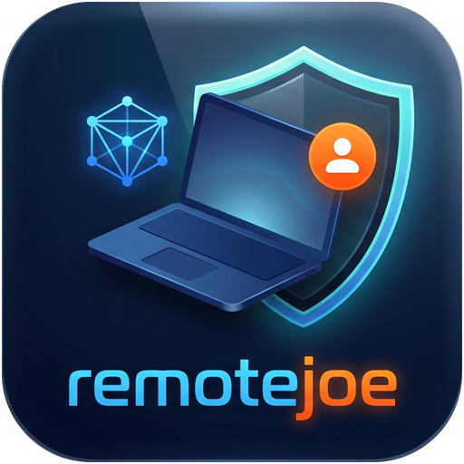
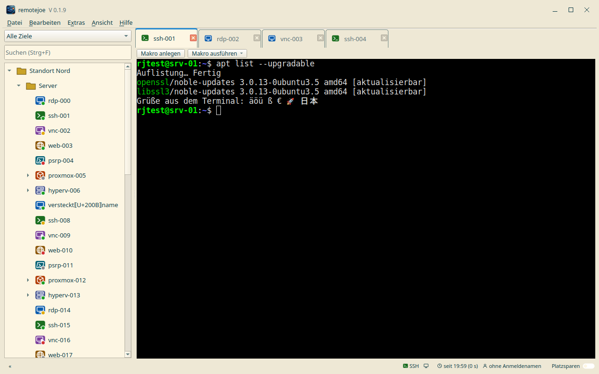
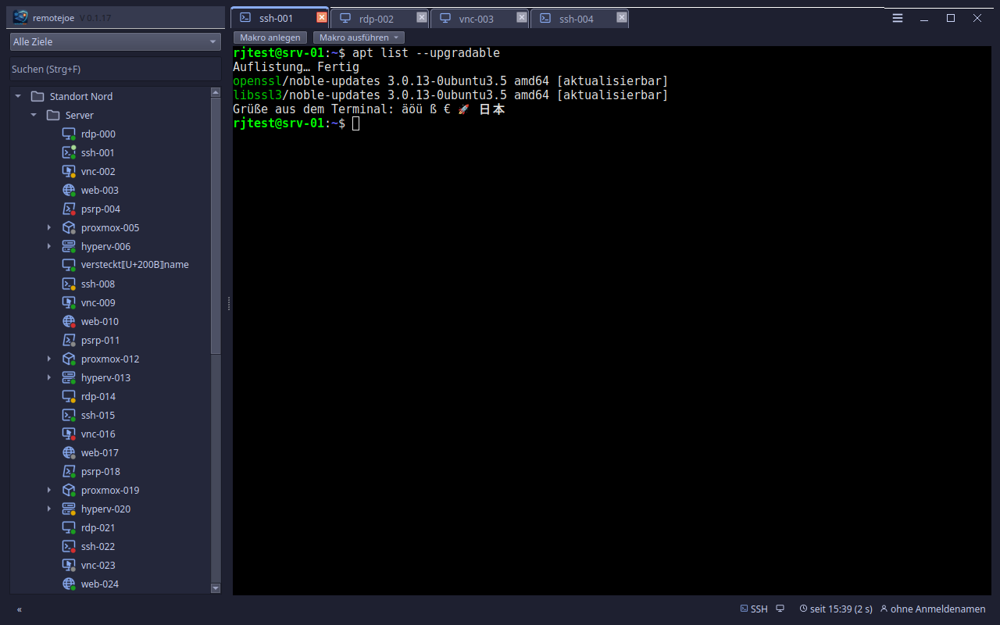
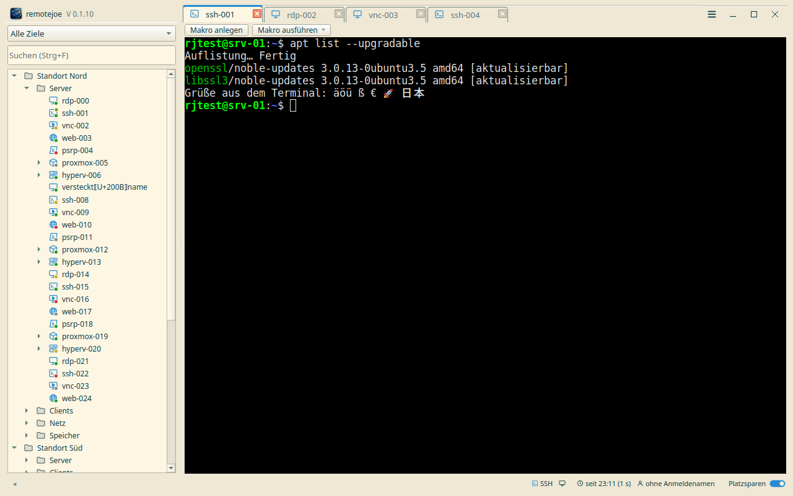
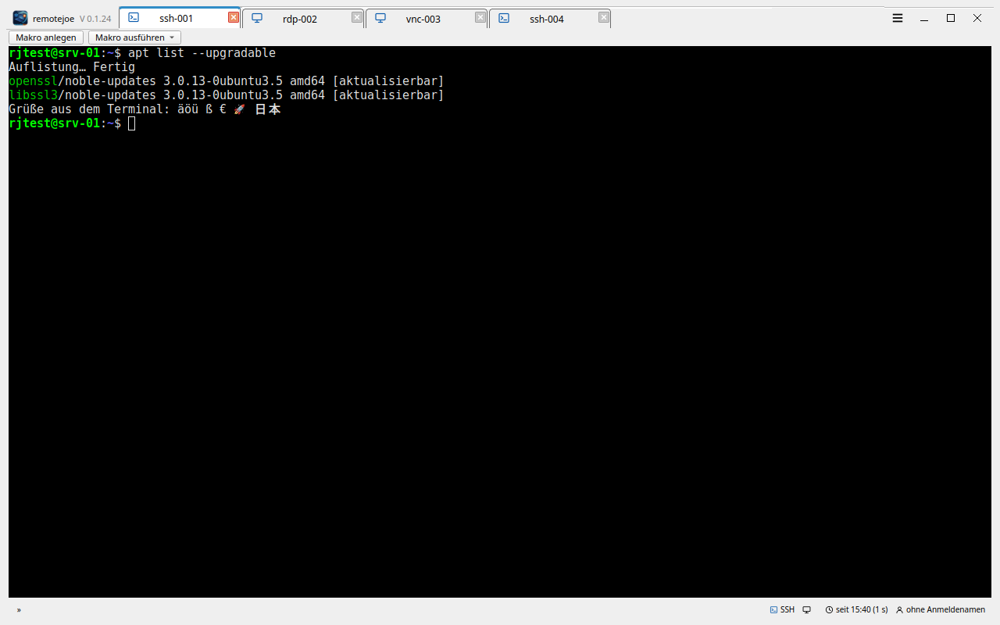
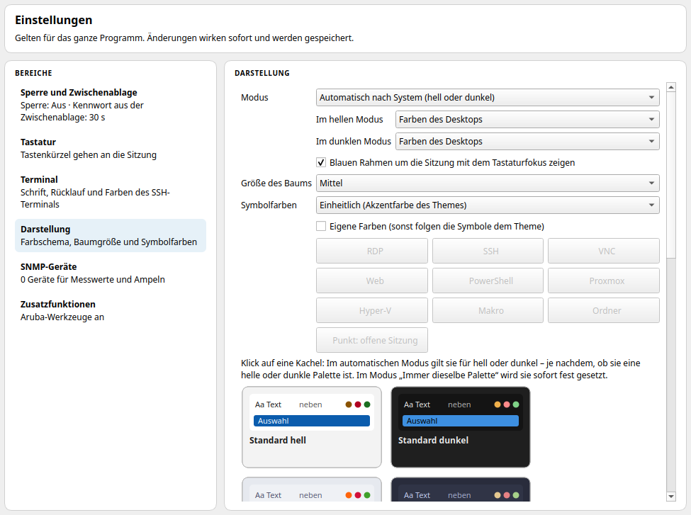
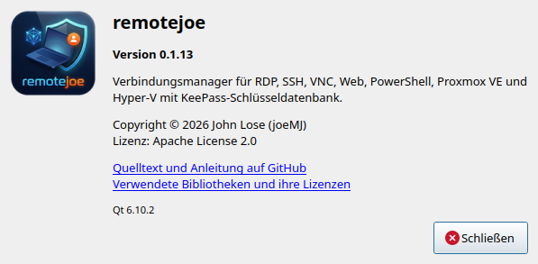
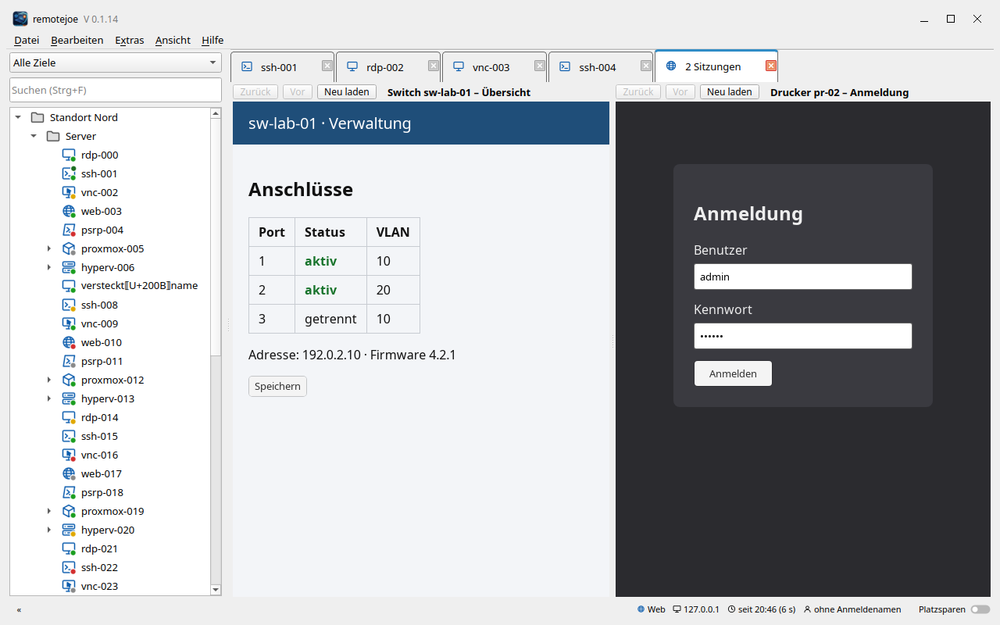

<p align="center">
  
</p>

# remotejoe

> **Verbindungsmanager für Ubuntu und Windows – RDP, SSH, VNC, Web, PowerShell, Proxmox VE und Hyper-V in einem Fenster, mit KeePass-Schlüsseldatenbank**

remotejoe bündelt alle Fernzugänge in einem schlanken, schnellen Programm:

- **Robust:** Jede Sitzung läuft in einem eigenen, überwachten Prozess mit eigener Speichergrenze.
  Stürzt eine Verbindung ab oder hängt sie, bleiben das Hauptfenster und alle anderen Sitzungen
  unberührt. Nach Standby oder Netzabbruch baut remotejoe die Verbindungen selbst wieder auf, Tunnel zuerst.
- **Extrem schnell, schlanker Quelltext:** Rust und natives Qt 6 – kein Electron, keine
  Laufzeitumgebung. Das Hauptfenster steht im Testlauf nach rund 150 ms, mit über 500 Einträgen im Baum.
- **Kompakt:** Im Platzsparmodus (F10) wandern die Tabs in die Titelzeile, das Menü hinter einen
  Knopf, und der Baum lässt sich einklappen (F9) – fast die ganze Fensterfläche gehört der Sitzung.

> [!WARNING]
> **Privates Hobbyprojekt – nicht gepflegt / unmaintained.**
> Dieses Repository ist für meinen eigenen Gebrauch gedacht und wird nur aus Bequemlichkeit öffentlich bereitgestellt.
>
> * **Keine Unterstützung zugesagt:** Pull Requests werden nicht bearbeitet, Feature-Wünsche nicht zugesagt. Fehler und Wünsche können als [Issue](https://github.com/joeMJ/remotejoe/issues) gemeldet werden – es kann aber dauern, bis ein Issue bearbeitet wird.
> * **Keine Garantie:** Bereitstellung „wie besehen“, ohne jede Gewährleistung und Haftung. Nutzung auf eigenes Risiko.
> * **Eigene Umgebung:** Entwickelt und getestet nur auf meinen eigenen Ubuntu-Rechnern (zuletzt 26.04). Auf anderen Systemen kann es fehlschlagen. Die Windows-Fassung ist neu und bisher nur auf einer Windows-10-VM erprobt.
> * **Zugangsdaten & Netzwerk:** Das Programm läuft mit den Rechten deines Benutzerkontos, öffnet Verbindungen zu den Zielen, die du einträgst, und verwaltet Zugangsdaten in einer KeePass-Datei (KDBX). Für die Update-Prüfung ruft es die Veröffentlichungen dieses Repositorys auf GitHub ab. **Lies den Code, bevor du ihn installierst.**
> * **Keine Updates zugesichert:** Es kann jederzeit ohne Ankündigung Änderungen, Brüche oder die Löschung des Repos geben.
>
> *Private hobby project, unmaintained, provided as-is. No guaranteed support, no warranty. Issues are welcome, but it may take a while until they are handled.*

<p align="center">
  
  <br>
  <em>Hauptfenster (helles Farbschema, Demo-Daten)</em>
  <br><br>
  
  <br>
  <em>Hauptfenster (Catppuccin Macchiato, Demo-Daten)</em>
  <br><br>
  
  <br>
  <em>Platzsparmodus (F10) mit Baum</em>
  <br><br>
  
  <br>
  <em>Platzsparmodus mit eingeklapptem Baum (F9)</em>
</p>

---

## Plattform-Übersicht

| Plattform | Status | Hinweis |
| :--- | :--- | :--- |
| **Linux (Ubuntu 26.04)** | Aktiv | Rust + Qt 6, eigener Prozess je Sitzung; Installation im Benutzerkonto; Pakete für 26.04 und für 24.04 (eigenes Paket mit Qt 6.4; gegen Qt 6.4.2 übersetzt und im Probelauf gestartet, auf einem echten 24.04-System noch nicht erprobt) |
| **Windows 10/11** | In Erprobung | MSI pro Benutzer ohne Administratorrechte (siehe unten); Web-Ziele im Tab über WebView2; bisher nur auf einer Windows-10-VM gebaut und geprüft. Bauanleitung [`docs/BUILD-WINDOWS.md`](docs/BUILD-WINDOWS.md) |

---

## Installation (Linux, Ubuntu)

**Voraussetzungen:** Ubuntu 26.04 oder 24.04 (24.04: eigenes Paket, noch nicht auf einem echten System erprobt), `curl`, `tar`, `zstd` und `openssl`. Kein `sudo` für das Programm selbst nötig – es wird im eigenen Benutzerkonto installiert (`~/.local`). Die benötigten Systembibliotheken (Qt 6, FreeRDP 3, WebKitGTK) kommen aus den Ubuntu-Paketquellen; das Skript prüft sie und nennt fehlende Pakete.

```bash
curl -fsSL https://raw.githubusercontent.com/joeMJ/remotejoe/main/install.sh | bash
```

Das Skript lädt die neueste signierte Veröffentlichung per HTTPS von GitHub, prüft Signatur und Prüfsumme, installiert nach `~/.local/opt/remotejoe`, legt den Starter und das Programmsymbol im Anwendungsmenü an und räumt danach auf.

**Erst ansehen, dann ausführen:**

```bash
curl -fsSLO https://raw.githubusercontent.com/joeMJ/remotejoe/main/install.sh
less install.sh
bash install.sh
```

**Aktualisieren:** im Programm **Hilfe → Nach Updates suchen …** (Pakete sind mit Ed25519 signiert und werden vor der Installation geprüft, siehe [`docs/UPDATE.md`](docs/UPDATE.md)) oder den Installationsbefehl erneut ausführen. Einstellungen und Schlüsseldatenbank bleiben unberührt.

**Deinstallieren:**

```bash
curl -fsSL https://raw.githubusercontent.com/joeMJ/remotejoe/main/install.sh | bash -s -- --uninstall
```

Entfernt Programm, Starter und Symbole. Dein Ordner `~/remotejoe` (Einstellungen, Daten) und deine Schlüsseldatenbank bleiben erhalten.

---

## Installation (Windows)

**Voraussetzungen:** Windows 10 oder 11 (64 Bit). Keine Administratorrechte nötig.

- **WebView2-Laufzeit** von Microsoft für Web-Ziele (Seiten im Tab). Unter Windows 10/11 meist schon
  vorhanden; fehlt sie, weist remotejoe beim Start mit einem Link darauf hin. Alle anderen Verbindungen
  gehen auch ohne.
- **PowerShell 7** (`pwsh`) für PowerShell-Remoting und Hyper-V-Ziele, z. B. `winget install Microsoft.PowerShell`.

**Installieren:** die Datei `remotejoe-<Version>-windows-x86_64.msi` von der
[Release-Seite](https://github.com/joeMJ/remotejoe/releases/latest) laden und doppelklicken. Sie installiert
nur für das eigene Benutzerkonto nach `%LOCALAPPDATA%\Programs\remotejoe`, legt eine Verknüpfung im
Startmenü an und erscheint unter „Apps und Features“. Die Visual-C++-Laufzeit ist enthalten.
Die MSI und die Programme sind signiert; damit Windows den Herausgeber kennt, siehe
[Zertifikat des Herausgebers](#windows-zertifikat-des-herausgebers).

> [!NOTE]
> **Warnung „Der Computer wurde durch Windows geschützt“:** Microsoft Defender SmartScreen zeigt diese
> Meldung bei Dateien, die noch selten heruntergeladen wurden – auch wenn sie signiert sind. So geht es weiter:
>
> 1. Auf **Weitere Informationen** klicken.
> 2. Prüfen, dass bei **Herausgeber** steht: `documentjoe, documentjoe Code Signing (privat)`.
> 3. Nur dann **Trotzdem ausführen** wählen.
>
> Steht dort „Unbekannter Herausgeber“, ist entweder das [Zertifikat](#windows-zertifikat-des-herausgebers)
> nicht eingetragen oder die Datei wurde verändert. Dann vor dem Ausführen die Prüfsumme vergleichen
> (PowerShell im Download-Ordner, Wert muss mit der Datei `….msi.sha256` der Release-Seite übereinstimmen):
>
> ```powershell
> Get-FileHash .\remotejoe-<Version>-windows-x86_64.msi -Algorithm SHA256
> ```

**Aktualisieren:** **Hilfe → Nach Updates suchen …** zeigt eine neue Version an und öffnet die
Release-Seite. Die neue MSI einfach darüber installieren; sie ersetzt die alte Fassung.

**Deinstallieren:** unter „Apps und Features“ (bzw. „Installierte Apps“) bei **remotejoe**. Dein Ordner
`%USERPROFILE%\remotejoe` (Einstellungen, Daten) und deine Schlüsseldatenbank bleiben erhalten.

---

## Windows: Zertifikat des Herausgebers

Die Windows-Pakete sind mit einem **selbst ausgestellten** Zertifikat signiert. Damit Windows bei der
Installation keinen „unbekannten Herausgeber“ meldet, kann man den öffentlichen Teil dieses Zertifikats
einmalig als vertrauenswürdig eintragen.

- Datei: [`docs/zertifikat/documentjoe-codesigning.cer`](docs/zertifikat/documentjoe-codesigning.cer)
- Name: `CN=documentjoe Code Signing (privat), O=documentjoe`, gültig bis 07.10.2041
- Verwendung: **nur Code-Signatur** (nicht für Webseiten oder E-Mail)
- Fingerabdruck (SHA-1): `C595450070432A501AADD72366C837AFB268740A`

**Eintragen** – PowerShell **als Administrator** öffnen, den ganzen Block kopieren und einfügen
(Windows 10 und 11, auch im eingeschränkten Sprachmodus). Das Skript lädt die Datei, prüft Prüfsumme
(SHA-256) und Fingerabdruck und trägt das Zertifikat nur dann ein, wenn beides stimmt. Ist es schon
eingetragen, tut es nichts.

```powershell
& {
    $ErrorActionPreference = 'Stop'
    $ProgressPreference    = 'SilentlyContinue'
    $url    = 'https://raw.githubusercontent.com/joeMJ/remotejoe/main/docs/zertifikat/documentjoe-codesigning.cer'
    $thumb  = 'C595450070432A501AADD72366C837AFB268740A'
    $sha256 = '6F672EFA23A39A4C26693BA4F979A4368E657400BCB9EA8E05214E29C80E5DAE'
    $stores = [ordered]@{ 'Root' = 'Vertrauenswürdige Stammzertifizierungsstellen'; 'TrustedPublisher' = 'Vertrauenswürdige Herausgeber' }
    $file   = Join-Path $env:TEMP 'documentjoe-codesigning.cer'
    function Step($t) { Write-Host "  ..   $t" -ForegroundColor Gray }
    function Ok($t)   { Write-Host "  OK   $t" -ForegroundColor Green }
    function Fail($t) { Write-Host "  FEHLER  $t" -ForegroundColor Red }

    Write-Host ''
    Write-Host '  remotejoe - Zertifikat des Herausgebers eintragen' -ForegroundColor Cyan
    Write-Host '  =================================================' -ForegroundColor Cyan
    Write-Host ''

    if (-not (whoami /groups | Select-String -SimpleMatch 'S-1-16-12288' -Quiet)) {
        Fail 'Diese PowerShell läuft nicht als Administrator.'
        Write-Host '         Bitte PowerShell mit "Als Administrator ausführen" öffnen und erneut einfügen.' -ForegroundColor Yellow
        Write-Host ''
        return
    }

    $missing = @($stores.Keys | Where-Object { -not (Test-Path "Cert:\LocalMachine\$_\$thumb") })
    if ($missing.Count -eq 0) {
        Ok 'Das Zertifikat ist bereits eingetragen. Es ist nichts zu tun.'
        Write-Host ''
        return
    }

    try {
        Step 'Zertifikat von GitHub laden'
        try {
            Invoke-WebRequest -Uri $url -OutFile $file -UseBasicParsing
        } catch {
            & curl.exe -fsSL -o $file $url
            if ($LASTEXITCODE -ne 0) { throw 'Das Zertifikat konnte nicht geladen werden. Bitte die Internetverbindung prüfen.' }
        }
        Ok 'Geladen'

        Step 'Echtheit prüfen'
        if ((Get-FileHash -Algorithm SHA256 -LiteralPath $file).Hash -ne $sha256) {
            throw 'Die Prüfsumme stimmt nicht. Das Zertifikat wird NICHT eingetragen.'
        }
        $cert = Get-PfxCertificate -FilePath $file
        if (-not $cert -or $cert.Thumbprint -ne $thumb) {
            throw 'Der Fingerabdruck stimmt nicht. Das Zertifikat wird NICHT eingetragen.'
        }
        Ok "Echt: $($cert.Subject)"
        Write-Host "         Fingerabdruck $thumb, gültig bis $($cert.NotAfter.ToString('dd.MM.yyyy'))" -ForegroundColor Gray

        foreach ($s in $missing) {
            Step "Eintragen in: $($stores[$s])"
            Import-Certificate -FilePath $file -CertStoreLocation "Cert:\LocalMachine\$s" | Out-Null
            Ok 'Eingetragen'
        }
        Write-Host ''
        Write-Host '  Fertig. Installationspakete von remotejoe werden jetzt als vertrauenswürdig erkannt.' -ForegroundColor Green
    } catch {
        Fail $_.Exception.Message
    } finally {
        if (Test-Path -LiteralPath $file) { Remove-Item -LiteralPath $file -Force }
    }
    Write-Host ''
}
```

Damit vertraut Windows allem, was mit diesem Zertifikat signiert ist. Wer das nicht möchte, lässt es weg
und bestätigt die Warnung bei der Installation von Hand. Die Warnung von SmartScreen zu selten
heruntergeladenen Dateien kann trotzdem erscheinen; sie hängt nicht am Zertifikat.

**Wieder entfernen** – ebenfalls in einer PowerShell als Administrator einfügen:

```powershell
& {
    $thumb  = 'C595450070432A501AADD72366C837AFB268740A'
    $stores = [ordered]@{ 'Root' = 'Vertrauenswürdige Stammzertifizierungsstellen'; 'TrustedPublisher' = 'Vertrauenswürdige Herausgeber' }

    Write-Host ''
    Write-Host '  remotejoe - Zertifikat des Herausgebers entfernen' -ForegroundColor Cyan
    Write-Host '  =================================================' -ForegroundColor Cyan
    Write-Host ''

    if (-not (whoami /groups | Select-String -SimpleMatch 'S-1-16-12288' -Quiet)) {
        Write-Host '  FEHLER  Diese PowerShell läuft nicht als Administrator.' -ForegroundColor Red
        Write-Host '         Bitte PowerShell mit "Als Administrator ausführen" öffnen und erneut einfügen.' -ForegroundColor Yellow
        Write-Host ''
        return
    }

    foreach ($s in $stores.Keys) {
        $path = "Cert:\LocalMachine\$s\$thumb"
        if (Test-Path $path) {
            try {
                Remove-Item $path -ErrorAction Stop
                Write-Host "  OK   Entfernt aus: $($stores[$s])" -ForegroundColor Green
            } catch {
                Write-Host "  FEHLER  $($stores[$s]): $($_.Exception.Message)" -ForegroundColor Red
            }
        } else {
            Write-Host "  --   Nicht vorhanden in: $($stores[$s])" -ForegroundColor Gray
        }
    }
    Write-Host ''
}
```

---

## Hyper-V und PowerShell-Remoting

remotejoe holt die Gäste eines Hyper-V-Hosts (Liste, Starten, Herunterfahren, Neu starten, Ausschalten)
und öffnet PowerShell-Sitzungen über ein **lokal installiertes PowerShell 7** (`pwsh`):

- Ubuntu: `sudo snap install powershell --classic`
- Windows: `winget install Microsoft.PowerShell`

Für die Verbindung zum Host gibt es zwei Transporte (Eigenschaften des Ziels → **PowerShell-Transport**):

| Transport | Von Windows aus | Von Ubuntu aus |
| :--- | :--- | :--- |
| **WinRM über HTTPS/HTTP** | ja – Einrichtung des Hosts siehe [`docs/ZIELE-EINRICHTEN.md`](docs/ZIELE-EINRICHTEN.md) | **nein** – PowerShell 7 hat unter Linux keinen WinRM-Client („…requires WSMan, and no supported WSMan client library was found“) |
| **SSH** | ja | ja |

Der Benutzer braucht auf dem Host Rechte für Hyper-V (Mitglied der Gruppe „Hyper-V-Administratoren“ oder
Administrator), sonst liefert `Get-VM` keine Gäste.

### Host für PowerShell über SSH einrichten

In einer PowerShell **als Administrator** auf dem Hyper-V-Host einfügen. Voraussetzung ist PowerShell 7 auf dem
Host. Der Block installiert bei Bedarf den OpenSSH-Server, startet ihn automatisch, trägt PowerShell als
SSH-Subsystem in `C:\ProgramData\ssh\sshd_config` ein (mit Sicherung) und gibt Port 22 in der Firewall frei.
Er ist mehrfach ausführbar.

```powershell
& {
    $ErrorActionPreference = 'Stop'
    $pwsh = 'C:\Program Files\PowerShell\7\pwsh.exe'
    $cfg  = Join-Path $env:ProgramData 'ssh\sshd_config'
    $line = 'Subsystem powershell c:/progra~1/powershell/7/pwsh.exe -sshs -nologo'
    function Ok($t)   { Write-Host "  OK      $t" -ForegroundColor Green }
    function Fail($t) { Write-Host "  FEHLER  $t" -ForegroundColor Red }
    Write-Host ''
    Write-Host '  remotejoe - PowerShell über SSH einrichten' -ForegroundColor Cyan
    Write-Host ''
    if (-not (whoami /groups | Select-String -SimpleMatch 'S-1-16-12288' -Quiet)) { Fail 'Bitte PowerShell als Administrator starten.'; return }
    if (-not (Test-Path $pwsh)) { Fail 'PowerShell 7 fehlt. Bitte zuerst installieren: https://aka.ms/powershell-release?tag=stable'; return }
    Ok 'PowerShell 7 vorhanden'
    try {
        $cap = Get-WindowsCapability -Online -Name 'OpenSSH.Server*' | Select-Object -First 1
        if ($cap.State -ne 'Installed') { Add-WindowsCapability -Online -Name $cap.Name | Out-Null; Ok 'OpenSSH-Server installiert' } else { Ok 'OpenSSH-Server vorhanden' }
        Set-Service sshd -StartupType Automatic
        Start-Service sshd
        $lines = @(Get-Content -LiteralPath $cfg)
        if ($lines | Select-String '^\s*Subsystem\s+powershell\b' -Quiet) {
            Ok 'Eintrag für PowerShell ist schon vorhanden'
        } else {
            Copy-Item -LiteralPath $cfg -Destination "$cfg.bak-remotejoe" -Force
            $at = -1
            for ($i = 0; $i -lt $lines.Count; $i++) { if ($lines[$i] -match '^\s*Subsystem\s') { $at = $i + 1; break } }
            if ($at -lt 0) { for ($i = 0; $i -lt $lines.Count; $i++) { if ($lines[$i] -match '^\s*Match\s') { $at = $i; break } } }
            if ($at -lt 0) { $at = $lines.Count }
            $new = @($lines[0..($at - 1)]) + $line + @(if ($at -lt $lines.Count) { $lines[$at..($lines.Count - 1)] })
            Set-Content -LiteralPath $cfg -Value $new -Encoding ascii
            Ok "Eintrag ergänzt (Sicherung: $cfg.bak-remotejoe)"
        }
        Restart-Service sshd
        Ok 'sshd neu gestartet'
        if (-not (Get-NetFirewallRule -Name 'OpenSSH-Server-In-TCP' -ErrorAction SilentlyContinue)) {
            New-NetFirewallRule -Name 'OpenSSH-Server-In-TCP' -DisplayName 'OpenSSH Server (sshd)' -Direction Inbound -Protocol TCP -LocalPort 22 -Action Allow | Out-Null
            Ok 'Firewall: Port 22 freigegeben'
        } else { Ok 'Firewall-Regel für SSH vorhanden' }
        Write-Host ''
        Write-Host '  Fertig. In remotejoe beim Hyper-V-Ziel den PowerShell-Transport auf SSH stellen.' -ForegroundColor Green
    } catch { Fail $_.Exception.Message }
    Write-Host ''
}
```

### Anmeldung per Schlüssel

Beim Transport SSH meldet sich PowerShell mit dem SSH-Schlüssel des eigenen Benutzerkontos an (`~/.ssh`,
bzw. ssh-agent); das Kennwort aus der Schlüsseldatenbank wird dabei **nicht** verwendet. Einmalig:

1. Auf dem eigenen Rechner einen Schlüssel erzeugen, falls noch keiner da ist: `ssh-keygen -t ed25519`
2. Den Inhalt von `~/.ssh/id_ed25519.pub` auf dem Host eintragen. Für ein Konto **mit Administratorrechten**
   in einer PowerShell als Administrator auf dem Host (Schlüsselzeile einsetzen):

   ```powershell
   & {
       $key = 'ssh-ed25519 AAAA… benutzer@rechner'
       $f   = Join-Path $env:ProgramData 'ssh\administrators_authorized_keys'
       Add-Content -LiteralPath $f -Value $key -Encoding ascii
       icacls $f /inheritance:r /grant '*S-1-5-32-544:F' /grant '*S-1-5-18:F' | Out-Null
       Write-Host '  OK  Schlüssel eingetragen' -ForegroundColor Green
   }
   ```

   Für ein Konto **ohne** Administratorrechte gehört die Zeile stattdessen in
   `%USERPROFILE%\.ssh\authorized_keys` im Profil dieses Benutzers.
3. Einmal von Hand verbinden und den Host-Schlüssel bestätigen, damit er in `~/.ssh/known_hosts` steht:
   `ssh benutzer@host exit`

Danach in remotejoe beim Hyper-V-Ziel den **PowerShell-Transport** auf **SSH** stellen und den Knoten im Baum
neu aufklappen.

---

## Was das Programm kann

- **Baum links, Sitzungen rechts:** Ordner und Ziele in fester Reihenfolge, Suche über Namen
  und Hosts (Strg+F). Sitzungen in Tabs, gekachelt (1×2, 2×2, frei) oder als eigenes Fenster.
- **RDP** mit Zwischenablage (Text in beide Richtungen, Dateien Ziel → Host), NLA und Grafikkanal
  (GFX; `Automatisch` wiederholt einen abgebrochenen Aufbau einmal mit GFX, GNOME-Remote-Desktop verlangt ihn).
- **SSH** mit Terminal, Zwischenablage (geschütztes Einfügen; OSC 52: Schreiben erlaubt, Lesen nur nach Nachfrage),
  Host-Schlüssel-Prüfung im OpenSSH-Format, Schlüssel aus KDBX-Anhängen. Das Mausrad blättert im
  Rücklauf (einstellbar bis 200 000 Zeilen). Für alte Geräte lässt sich je Ziel „Unsichere ältere
  SSH-Verfahren zulassen“ einschalten (SHA-1-Schlüsselaustausch, CBC, HMAC-SHA1, DSA).
- **VNC** (eigene Umsetzung) mit TLS (VeNCrypt), Zertifikatsprüfung per Fingerabdruck und
  UTF-8-Zwischenablage.
- **Web** im Tab wie RDP und VNC, auch gekachelt: Die Seite wird im Worker ohne eigenes
  Fenster gerendert (WebKitGTK); Zurück, Vor, Neu laden in der Kopfzeile, Seitentitel als
  Tab-Titel, Zwischenablage über das Hauptprogramm, eigenes Browserprofil je Ziel und
  automatische Formular-Anmeldung mit „Felder erkennen“ (auch bei Seiten, die ihr Formular erst nach
  dem Laden aufbauen). Anmeldung und Seitenwechsel werden je Ziel mit Zeiten protokolliert
  (`protokoll.log` im Profilordner, ohne Eingaben). Unter Windows über WebView2 (Microsoft Edge).
- **PowerShell-Remoting** (WinRM oder SSH) über ein lokal installiertes PowerShell 7.
- **Proxmox VE und Hyper-V:** Ziele im Baum aufklappen, Gäste starten, herunterfahren, neu
  starten, ausschalten und deren Konsole öffnen.
- **Tunnel:** SSH-Sprungserver (auch mehrstufig), WireGuard ohne Systemadapter, oder ein
  vorhandenes VPN.
- **Aufgaben:** Aktualisierungen prüfen und einspielen (apt über SSH, Windows Update über
  PowerShell), als „Patchday“ für viele Ziele parallel.
- **SNMP-Ampel** am Baum (CPU, Speicher, Schnittstellen) mit Verlauf.
- **Import** aus Remote Desktop Manager (`.rdm`, JSON, CSV) und Royal TS (`.rtsz`, `.rtsx`). Eine
  RDM-CSV enthält Kennwörter im Klartext: Sie werden nur in die Schlüsseldatenbank übernommen, der
  Import weist darauf hin, die Datei danach sicher zu löschen.
- **Bearbeiten im Hauptfenster:** Ordner und Ziele anlegen, ändern, verschieben, duplizieren
  und löschen im Eigenschaften-Tab, Vorlagen je Zieltyp, Favoriten, Ansichten (z. B.
  „Patchday“), „Auf Unterobjekte anwenden“, Rückgängig.
- **Mehrere Ziele auf einmal anlegen:** ein Host pro Zeile (bis 500), Namensmuster mit
  `{host}` und `{nr}`, Vorlage und Zugangsdaten, Vorschau mit Hinweisen je Zeile; alles als eine
  rückgängig machbare Aktion.
- **Entsperren mit dem Schlüsselbund (optional, Standard aus):** An der Entsperrmaske lässt sich das
  Hauptkennwort im Schlüsselbund des Systems merken (Linux: Secret Service/GNOME-Schlüsselbund, Windows:
  Anmeldeinformationsverwaltung). Danach entsperrt der Programmstart damit; nach „Sperren“ oder Leerlauf ist das
  Kennwort wieder nötig. Wer das Benutzerkonto entsperrt hat, kommt so an die Datenbank. Entfernen: Datei →
  „Gemerktes Hauptkennwort aus dem Schlüsselbund entfernen“.
- **Export (Datei → Exportieren …):** Ordner, Ziele und Optionen als **JSON** (remotejoe, wieder importierbar) oder als
  **CSV im Stil von RDM**, für den ganzen Baum oder die Auswahl. Benutzername und Domäne gehören dazu, Kennwörter nur
  auf Wunsch; JSON mit Kennwörtern gibt es nur in einem **verschlüsselten ZIP** (AES-256, öffnen mit 7-Zip oder
  WinZip), das Kennwort dafür vergibst du beim Export. Die Datei ist nur für dein Konto lesbar. Der Import liest
  JSON, CSV und ZIP und fragt bei einem verschlüsselten ZIP nach dem Kennwort.
- **Zugangsdaten kopieren:** Im Kontextmenü eines Ziels „Benutzernamen kopieren“ und „Kennwort kopieren“
  (Eintrag als „geheim“ markiert, die Zwischenablage wird nach 30 s geleert; Frist unter Extras).
- **Eigene Titelleiste** mit Logo, Name und Version, **Darstellung** (System hell/dunkel oder eigene
  Paletten, Fokusrahmen abschaltbar) und **Über**-Dialog; die Fenstergröße wird beim Beenden gemerkt,
  und bei ungespeicherten Änderungen fragt das Programm nach.
- **Keine Dialogfenster:** Rückfragen, Hinweise und Fehlermeldungen erscheinen als Leiste im
  Tab oder im Hauptfenster; Import-Vorschau und Patchday sind Tabs.
- **Updates** aus den Veröffentlichungen dieses Repositorys auf GitHub:
  Hilfe → Nach Updates suchen …; Pakete sind mit Ed25519 signiert und werden vor der
  Installation geprüft (siehe [`docs/UPDATE.md`](docs/UPDATE.md)).
- **Alle im Ordner verbinden**, neu verbinden oder trennen (gestaffelt, höchstens 4
  gleichzeitig).
- **Sperre nach Leerlauf** (Vorgabe aus) und Sperren von Hand; nach dem Aufwachen aus dem
  Standby werden abgebrochene Verbindungen sofort neu aufgebaut, Tunnel zuerst.
- Jede Verbindung läuft in einem eigenen Prozess: Absturz oder Hänger einer Sitzung betrifft
  die anderen nicht.

## Das Hybridmodell: KDBX und Index

remotejoe trennt Zugangsdaten und Struktur:

1. **Zugangsdaten** sind ganz normale Einträge in der KDBX (Titel, Benutzer, Kennwort,
   Anhänge). Man pflegt sie wie gewohnt, auch mit KeePassXC.
2. **Struktur und Einstellungen** (Ordner, Ziele, Protokolloptionen, Tunnel, Aufgaben) stehen
   im **Index**. Der Index liegt verschlüsselt in derselben KDBX-Datei (als interne
   Zusatzdaten, KeePassXC lässt ihn unverändert) und verweist per UUID auf die Einträge.
3. **Vererbung:** Ein Zugangsdatensatz, ein Tunnel oder der PowerShell-Transport, der an einem
   Ordner hinterlegt ist, gilt für alle Ziele darunter, bis ein Unterordner oder das Ziel etwas
   anderes festlegt. Zugangsdatensätze haben Namen (`default`, `root`, …); ein Ziel kann einen
   bestimmten Namen verlangen. Benutzername und Domäne lassen sich je Ordner überschreiben,
   das Kennwort nicht.

Es gibt also nur eine Datei zum Sichern und Synchronisieren. Wird die KDBX gleichzeitig an
anderer Stelle geändert, führt remotejoe beim Speichern zusammen und fragt nur, wenn beide
Seiten den Index geändert haben. Einzelheiten: [`docs/DATENMODELL.md`](docs/DATENMODELL.md).

Kennwörter werden byte-genau verwendet (nie normalisiert, getrimmt oder umkodiert) und nie über
die Zwischenablage in ein Ziel gebracht. Protokolle enthalten nur Fehler und
Verbindungsereignisse, keine Kennwörter, Eingaben oder Inhalte der Zwischenablage.

## Bedienung

1. Programm starten: `remotejoe`. Beim ersten Start fragt die Abdeckung des Hauptfensters nach der
   **Schlüsseldatenbank** (eine KeePass-Datei mit Ihren Zugangsdaten): **Vorhandene öffnen** oder **Datei →
   Neue Schlüsseldatenbank anlegen …** (Datei, Hauptkennwort mit Wiederholung, auf Wunsch eine Schlüsseldatei).
   Der Pfad wird gemerkt.
2. Struktur anlegen: im Baum **Hinzufügen** (Kontextmenü, Menü „Bearbeiten“ oder Strg+N):
   Ordner, RDP, SSH, VNC, Web, Proxmox, Hyper-V, PowerShell, Aufgabe, Makro oder aus einer
   Vorlage. Das neue Objekt öffnet seinen **Eigenschaften-Tab** (später über F4, Alt+Eingabe oder das Kontextmenü „Eigenschaften“; der Doppelklick auf ein Ziel verbindet):
   Allgemein, Verbindung, Zugangsdaten, Tunnel, Aufgaben und Makros, Zwischenablage,
   Organisation, Übergeordneter Ordner; **Speichern** im Tab.
   Oder **Datei → Importieren (RDM, Royal TS, remotejoe-Export) …** mit Vorschau.
3. Zugangsdaten je Ordner oder Ziel: keine, vom übergeordneten Ordner, Benutzername und
   Kennwort direkt (neuer Eintrag in der Gruppe `remotejoe` der Schlüsseldatenbank), vorhandener Datensatz oder
   Datensatz nach Name. Der Tab zeigt, woher der wirksame Wert kommt.
4. Verbinden: Eingabetaste auf einem Ziel oder Kontextmenü **Verbinden**; für einen Ordner
   **Alle im Ordner verbinden**. Fehlt ein Eintrag oder kommen mehrere in Frage, fragt das
   Programm nach. Tunnel werden im Hintergrund aufgebaut (Fortschritt und „Abbrechen“ in der
   Statuszeile).
5. **Bearbeiten → Hinzufügen → Mehrere Ziele …** öffnet einen Tab: Hosts einfügen (ein Host
   pro Zeile, `#` für Kommentare), Vorschau prüfen, Strg+Eingabe legt an; Zeilen mit Fehlern
   bleiben im Feld stehen.
   Baum per Tastatur: F2 umbenennen, Entf löschen, Strg+D duplizieren, Strg+Umschalt+M
   verschieben (auch Ziehen und Ablegen, Alt+↑/↓), Strg+B Favorit, Strg+Z rückgängig.
   Über dem Baum lässt sich zwischen allen Zielen, Favoriten und eigenen Ansichten wählen.
6. Rückfragen zu unbekannten Host-Schlüsseln und Zertifikaten erscheinen als Leiste im Tab der
   Sitzung mit Schlüsseltyp und vollständigem Fingerabdruck; Standard ist „Ablehnen“, ohne
   Antwort wird nach 120 s abgelehnt. Ein geänderter Schlüssel wird deutlich gewarnt (alter und
   neuer Fingerabdruck) und lässt sich erst nach ausdrücklicher Bestätigung annehmen. Die
   Liste bekannter SSH-Host-Schlüssel (`known_hosts`) hat das Format von OpenSSH.
7. Kontextmenü **Aufgaben → Aktualisierungen prüfen** startet den Patchday für die gewählten
   Ziele (zuerst als Trockenlauf).
8. **Datei → Speichern** schreibt Schlüsseldatenbank und Index (atomar, mit Sicherungskopie `.bak`); hat
   jemand die Schlüsseldatenbank inzwischen geändert, fragt eine Leiste: eigene, fremde oder beide behalten.
   **Datei → Sperren** (Strg+L) verwirft Schlüssel und Kennwörter im Speicher; laufende
   Sitzungen bleiben bestehen, ihre Bilder sind verdeckt. **Extras → Sperre nach Leerlauf**
   schaltet das automatische Sperren ein; **Extras → SNMP-Geräte** verwaltet SNMP-Zugänge (v3
   mit getrennten Kennwörtern für Authentisierung und Verschlüsselung).

9. **Fußzeile:** zeigt für die vordere Sitzung den Verbindungstyp, das Ziel, seit wann und als wer
   Sie verbunden sind.
10. **Terminal:** **Extras → Terminal …** (Schrift, Größe, Farbschema mit Catppuccin und weiteren
    Schemata, eigene Farben, Größe des Rücklaufs); das Mausrad blättert im Rücklauf (3 Zeilen je
    Raste, Umschalt + Bild↑/↓ seitenweise; bei `less`/`top` senden sie Pfeiltasten), Strg + Mausrad
    ändert die Schriftgröße direkt im Terminal. Kopieren und Einfügen: Rechtsklick-Menü, Strg+Einfg und
    Umschalt+Einfg (auch Strg+Umschalt+C/V), Doppelklick wählt ein Wort, Dreifachklick die Zeile; markierter
    Text geht auf Wunsch sofort in die Zwischenablage, mehrzeiliges Einfügen fragt nach (beides einstellbar).
11. **Makros** (SSH): Im Baum liegt das Fach **Makros**; Makros werden Zielen oder Ordnern
    zugeordnet (vererbt). In der Kopfzeile jeder SSH-Sitzung legt **Makro anlegen** ein Makro für
    dieses Ziel an, **Makro ausführen ▾** startet eines der zugeordneten. Schritte sind „Senden“
    und „Warten auf“ (Text oder regulärer Ausdruck, Zeitlimit, Fehlermuster); das Kennwort kommt
    als Platzhalter aus den Zugangsdaten der Sitzung und steht nie im Protokoll.
    **Tastenfolge nach dem Verbinden** (RDP und SSH, je Ziel unter Verbindung → „Nach dem Verbinden“):
    eine Zeile je Schritt – `Taste Enter`, `Text {cred:password}`, `Pause 500` –, zum Beispiel für die
    zweite Anmeldung am Ubuntu-Desktop nach dem Verbinden; hat die Sitzung ein anderes Kennwort, legt
    man dafür einen zweiten benannten Zugangsdatensatz an und schreibt `Text {cred:Name:password}`. Auslöser ist eine feste Wartezeit oder „Bild
    bzw. Ausgabe wird ruhig“; wählbar ist auch, ob beim Neuverbinden erneut gesendet wird. Die Folge
    läuft nur, wenn man sie am Ziel einschaltet, das Kennwort wird getippt (nicht kopiert) und nie
    protokolliert, **Esc** bricht sie ab.

12. **Hilfe** enthält „Nach Updates suchen …“, „Hilfe“ (diese Anleitung auf GitHub) und „Über
    remotejoe …“; die **Darstellung** (Farbschema, Fokusrahmen) steht im Menü Extras.

<p align="center">
  
  &nbsp;
  
</p>

Zum Ausprobieren ohne eigene Daten: `remotejoe --demo` (erfundene Ziele, Vorführsitzungen).

**Ablage:** Neue Installationen legen alles in **einem Ordner** unter dem persönlichen Ordner ab:
`~/remotejoe/` (Windows: `%USERPROFILE%\remotejoe\`) mit `config.toml`, `paletten/` (eigene Farbpaletten) und
`daten/` (bekannte Host-Schlüssel, Zertifikate, Browser- und FreeRDP-Profile). Als Vorschlag für die
Schlüsseldatenbank gilt dort `remotejoe.kdbx`. Der Ordner lässt sich mit der Umgebungsvariable `REMOTEJOE_HOME`
wählen. **Bestehende Installationen bleiben, wo sie sind** (`~/.config/remotejoe`, `~/.local/share/remotejoe`);
dasselbe gilt, wenn `XDG_CONFIG_HOME` oder `XDG_DATA_HOME` gesetzt ist. Es wird nichts verschoben. Nicht
mit Syncthing oder Ähnlichem abgleichen, solange der Ordner Browserprofile enthält.

Einstellungen stehen in `~/remotejoe/config.toml` (alte Installationen: `~/.config/remotejoe/config.toml`), z. B.:

```toml
kdbx_path = "/home/benutzer/zugang.kdbx"

[connection]
connect_timeout_secs = 15
keepalive_secs = 30
auto_reconnect = false
connect_all_parallel = 4

[security]
lock_after_idle_mins = 0      # 0 = aus
disconnect_on_lock = false

[update]
check_on_start = false        # beim Start im Hintergrund prüfen

[appearance]
scheme = "system"             # system, hell, dunkel oder datei:<Name>
focus_frame = true
```

## Bauen unter Ubuntu 24.04

```sh
sudo apt install build-essential pkg-config cmake clang libclang-dev \
    qt6-base-dev qt6-base-dev-tools qt6-svg-dev qmake6 \
    freerdp3-dev libwinpr3-dev
# für den Web-Worker zusätzlich:
sudo apt install libwebkit2gtk-4.1-dev libgtk-3-dev
# Rust (stable) über https://rustup.rs
cargo build --release
cargo build --release -p remotejoe-worker-web --features webview
```

Die Programme liegen danach in `target/release/`: `remotejoe` und die Worker `rj-worker-ssh`,
`rj-worker-rdp`, `rj-worker-vnc`, `rj-worker-psrp`, `rj-worker-web`. Die Worker müssen im
selben Ordner wie `remotejoe` liegen.

Für PowerShell-Remoting und Hyper-V muss PowerShell 7 (`pwsh`) installiert sein.

Werkzeug für Herausgeber von Updates (Schlüssel, Packen, Signieren, Hochladen):
`cargo build --release -p remotejoe-update-tool` (liefert `rj-update`, siehe `docs/UPDATE.md`).

Tests: `cargo test --workspace`. Tests gegen lokale Server (sshd, xrdp, Xvnc, snmpd) laufen,
wenn diese installiert sind, sonst werden sie übersprungen. Web-Tests mit echter WebView:
`xvfb-run -a cargo test -p remotejoe-worker-web --features webview` (braucht `xvfb`).



## Bauen unter Windows 10/11

Voraussetzungen: Visual Studio Build Tools (MSVC), Rust (`x86_64-pc-windows-msvc`), Qt 6
(Widgets, Svg), LLVM (für bindgen) und FreeRDP 3 über vcpkg. Schritt-für-Schritt-Anleitung mit
Stolpersteinen: [`docs/BUILD-WINDOWS.md`](docs/BUILD-WINDOWS.md). Das Skript
`scripts/build-windows.ps1` prüft die Voraussetzungen, baut alles und legt ein Paket mit den
nötigen DLLs an:

```powershell
.\scripts\build-windows.ps1 -VcpkgRoot C:\vcpkg -QtDir C:\Qt\6.5.3\msvc2019_64
```

Daraus baut `scripts/build-msi.ps1` mit WiX 3.14 die signierte MSI unter `target\msi`
(Beschreibung: [`packaging/windows/remotejoe.wxs`](packaging/windows/remotejoe.wxs)):

```powershell
.\scripts\build-msi.ps1 -WixDir "C:\Program Files (x86)\WiX Toolset v3.14\bin"
```

## Dokumentation

- [`docs/UPDATE.md`](docs/UPDATE.md) – Updates: Quelle einstellen, Pakete packen, signieren und veröffentlichen
- [`docs/ARCHITEKTUR.md`](docs/ARCHITEKTUR.md) – Aufbau: Bausteine, Prozessmodell, Zusammenspiel der Prozesse, Oberfläche
- [`docs/DATENMODELL.md`](docs/DATENMODELL.md) – Datenmodell: Index, Verweise auf Zugangsdaten, Vererbung, Ablage in der KDBX
- [`docs/BUILD-WINDOWS.md`](docs/BUILD-WINDOWS.md) – remotejoe unter Windows bauen
- [`docs/ZIELE-EINRICHTEN.md`](docs/ZIELE-EINRICHTEN.md) – Windows-Ziele für RDP und PowerShell-Remoting einrichten (mit Skripten unter [`tools/ziel-einrichten/`](tools/ziel-einrichten/))
- [`THIRD_PARTY.md`](THIRD_PARTY.md) – verwendete Bibliotheken Dritter mit Lizenzen

## Fehler melden und Wünsche

Fehler und Wünsche bitte als [Issue auf GitHub](https://github.com/joeMJ/remotejoe/issues) melden
(im Programm: **Hilfe → Fehler melden / Wünsche**). Es kann dauern, bis ein Issue bearbeitet wird.

Hilfreich sind:

- Version (**Hilfe → Über remotejoe**) und System (z. B. Ubuntu 26.04, Windows 11 24H2)
- Art des Ziels (RDP, SSH, VNC, Web, PowerShell, Proxmox, Hyper-V) und was genau passiert
- Schritte, mit denen sich der Fehler wiederholen lässt, und der Wortlaut einer Meldung

**Nie mitschicken:** Kennwörter, Schlüssel, Tokens, die Schlüsseldatenbank (KDBX) oder `config.toml`.
Interne Adressen, Host- und Benutzernamen in Bildschirmfotos und Meldungen bitte unkenntlich machen.

## Lizenz

Apache License 2.0, siehe [`LICENSE`](LICENSE) und [`NOTICE`](NOTICE). Copyright 2026 joeMJ.
Verwendete Bibliotheken mit ihren Lizenzen: [`THIRD_PARTY.md`](THIRD_PARTY.md).
