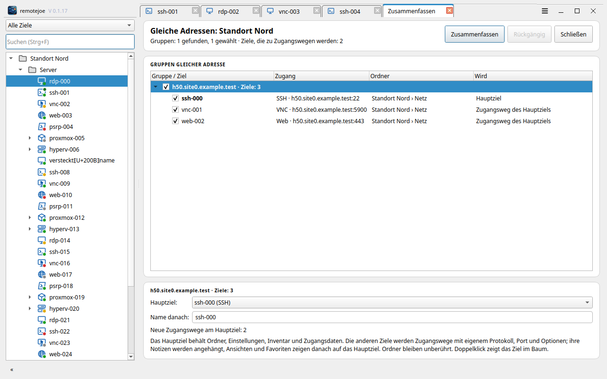
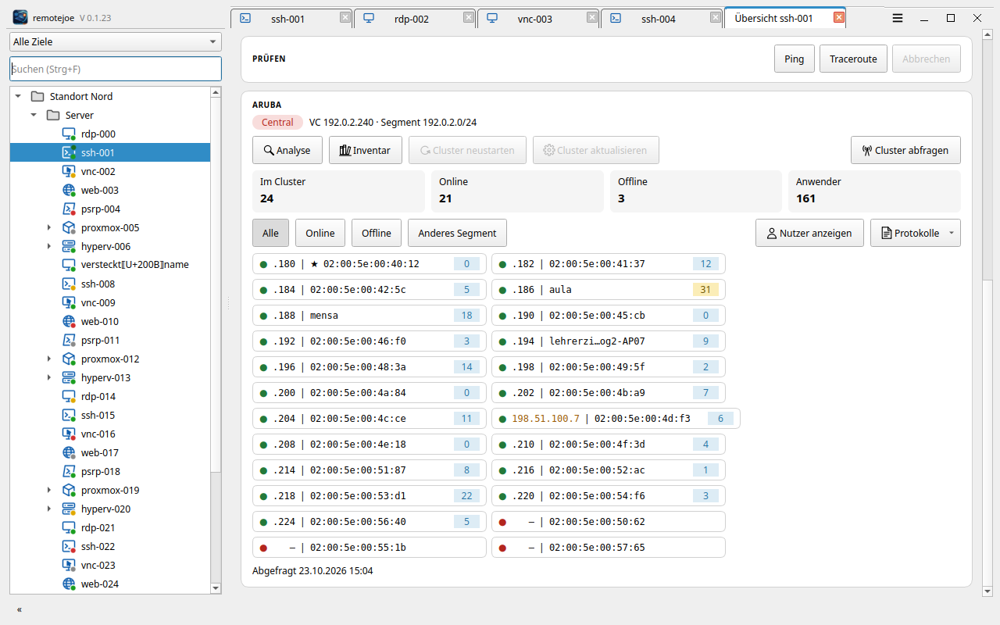
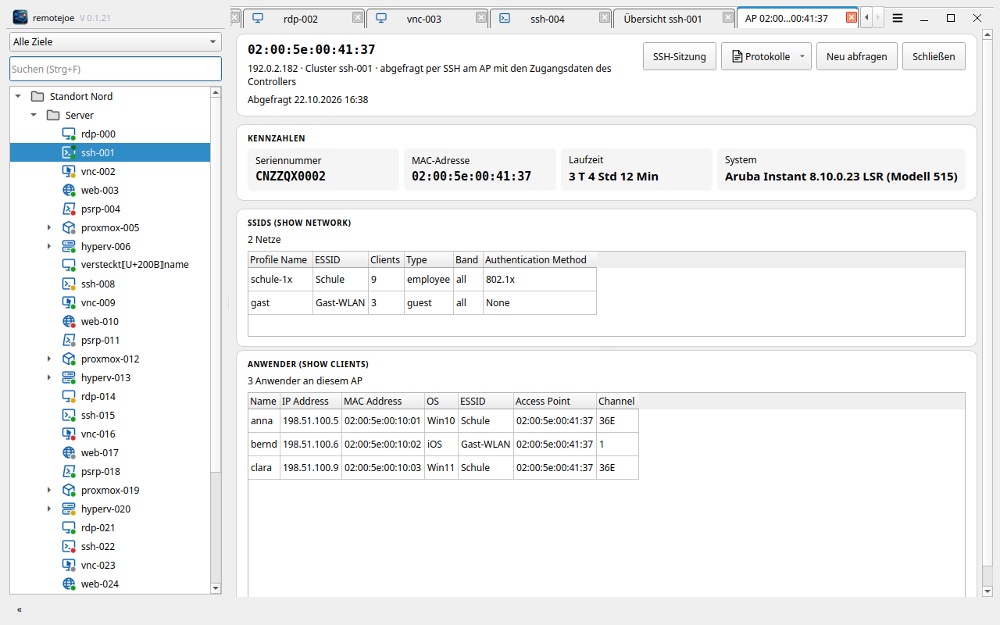
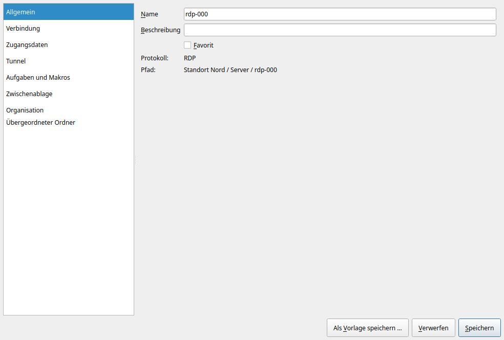
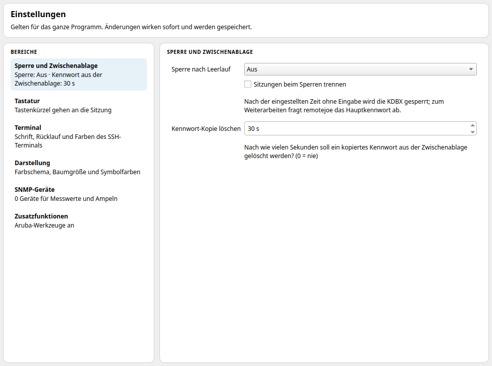
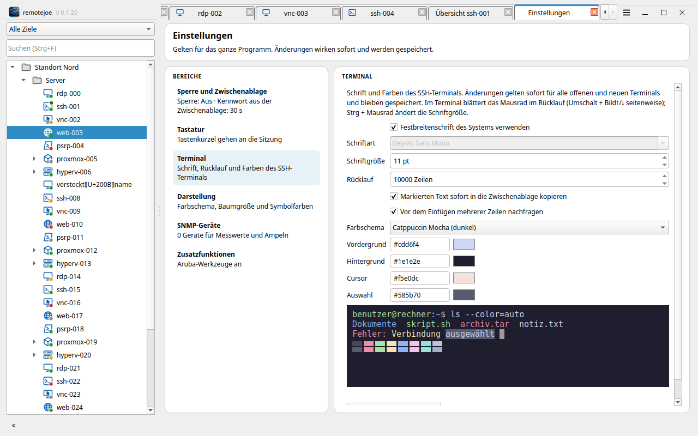

<p align="center">
  
</p>

# remotejoe

> **Schlanker, sehr schneller und robuster Verbindungsmanager für Tausende von Zielen – unter Ubuntu und Windows.**
> RDP, SSH, VNC, Web, PowerShell, Proxmox VE und Hyper-V in einem Fenster, Zugangsdaten in einer KeePass-Schlüsseldatenbank.

<p align="center">
  <a href="https://www.johnlose.de/unterstutzung-fur-john-joe-lose/"></a>
</p>
<p align="center">
  <a href="docs/INSTALLATION.md#installation-windows"></a>
  &nbsp;
  <a href="docs/INSTALLATION.md#installation-linux-ubuntu"></a>
</p>

remotejoe bündelt alle Fernzugänge in einem schlanken, schnellen Programm:

- **Robust:** Jede Sitzung läuft in einem eigenen, überwachten Prozess mit eigener Speichergrenze.
  Stürzt eine Verbindung ab oder hängt sie, bleiben das Hauptfenster und alle anderen Sitzungen
  unberührt. Nach Standby oder Netzabbruch baut remotejoe die Verbindungen selbst wieder auf, Tunnel zuerst.
- **Extrem schnell, schlanker Quelltext:** Rust und natives Qt 6 – kein Electron, keine
  Laufzeitumgebung. Das Hauptfenster steht im Testlauf nach rund 150 ms, mit über 500 Einträgen im Baum.
- **Kompakt:** Die Tabs stehen in der Titelzeile, das Menü hinter einem Knopf, und der Baum lässt sich
  einklappen (F9) – fast die ganze Fensterfläche gehört der Sitzung. Beim Start ist der Baum ausgeklappt.

> [!WARNING]
> **Privates Hobbyprojekt – nicht gepflegt / unmaintained.**
> Dieses Repository ist für meinen eigenen Gebrauch gedacht und wird nur aus Bequemlichkeit öffentlich bereitgestellt.
>
> * **Keine Unterstützung zugesagt:** Pull Requests werden nicht bearbeitet, Feature-Wünsche nicht zugesagt. Fehler und Wünsche können als [Issue](https://github.com/joeMJ/remotejoe/issues) gemeldet werden – es kann aber dauern, bis ein Issue bearbeitet wird.
> * **Keine Garantie, Haftung:** Das Programm wird unentgeltlich als Privatprojekt „wie besehen“ bereitgestellt. Es besteht kein Anspruch auf Verfügbarkeit, Fehlerfreiheit, Aktualisierungen oder Support. Für Schäden aus der Nutzung hafte ich nur bei Vorsatz, grober Fahrlässigkeit sowie bei Verletzung von Leben, Körper oder Gesundheit; im Übrigen nur nach den gesetzlichen Vorschriften.
> * **Eigene Umgebung:** Entwickelt und getestet nur auf meinen eigenen Ubuntu-Rechnern (zuletzt 26.04). Auf anderen Systemen kann es fehlschlagen. Die Windows-Fassung ist neu (Windows 10 und 11).
> * **Zugangsdaten & Netzwerk:** Das Programm läuft mit den Rechten deines Benutzerkontos, öffnet Verbindungen zu den Zielen, die du einträgst, und verwaltet Zugangsdaten in einer KeePass-Datei (KDBX). Für die Update-Prüfung ruft es die Veröffentlichungen dieses Repositorys auf GitHub ab. **Lies den Code, bevor du ihn installierst.**
> * **Keine Updates zugesichert:** Es kann jederzeit ohne Ankündigung Änderungen, Brüche oder die Löschung des Repos geben.
>
> *Private hobby project, unmaintained, provided as-is. No guaranteed support, no warranty. Issues are welcome, but it may take a while until they are handled.*

<p align="center">
  
  <br>
  <em>Hauptfenster (helles Farbschema, Demo-Daten)</em>
  <br><br>
  
  <br>
  <em>Hauptfenster (Catppuccin Macchiato, Demo-Daten)</em>
  <br><br>
  
  <br>
  <em>Mit eingeklapptem Baum (F9)</em>
</p>

---

## Plattform-Übersicht

| Plattform | Status | Hinweis |
| :--- | :--- | :--- |
| **Linux (Ubuntu 26.04)** | Aktiv | Rust + Qt 6, eigener Prozess je Sitzung; Installation im Benutzerkonto; Pakete für 26.04 und für 24.04 (eigenes Paket mit Qt 6.4) |
| **Windows 10/11** | Aktiv | MSI pro Benutzer ohne Administratorrechte ([Installation](docs/INSTALLATION.md#installation-windows)); Web-Ziele im Tab über WebView2 |

---

## Installation

Die vollständige Anleitung steht in [`docs/INSTALLATION.md`](docs/INSTALLATION.md).

- **Ubuntu 26.04 / 24.04:** im eigenen Benutzerkonto, ohne `sudo` für das Programm –
  [Installation (Linux, Ubuntu)](docs/INSTALLATION.md#installation-linux-ubuntu):

  ```bash
  curl -fsSL https://raw.githubusercontent.com/joeMJ/remotejoe/main/install.sh | bash
  ```

- **Windows 10/11:** MSI pro Benutzer ohne Administratorrechte –
  [Installation (Windows)](docs/INSTALLATION.md#installation-windows).

> [!IMPORTANT]
> **Windows: vor der ersten Installation das Zertifikat des Herausgebers eintragen.** Die MSI ist mit einem selbst
> ausgestellten Zertifikat signiert; ohne eingetragenes Zertifikat meldet Windows einen „unbekannten Herausgeber“.
> Befehl, Fingerabdruck und Erklärung: [Zertifikat des Herausgebers](docs/INSTALLATION.md#zertifikat-des-herausgebers).

---

## Hyper-V und PowerShell-Remoting

remotejoe holt die Gäste eines Hyper-V-Hosts (Liste, Starten, Herunterfahren, Neu starten, Ausschalten)
und öffnet PowerShell-Sitzungen über ein **lokal installiertes PowerShell 7** (`pwsh`):

- Ubuntu: `sudo snap install powershell --classic`
- Windows: `winget install Microsoft.PowerShell`

Für die Verbindung zum Host gibt es zwei Transporte (Eigenschaften des Ziels → **PowerShell-Transport**):

| Transport | Von Windows aus | Von Ubuntu aus |
| :--- | :--- | :--- |
| **WinRM über HTTPS/HTTP** | ja – Einrichtung des Hosts siehe [`docs/ZIELE-EINRICHTEN.md`](docs/ZIELE-EINRICHTEN.md) | **nein** – PowerShell 7 hat unter Linux keinen WinRM-Client („…requires WSMan, and no supported WSMan client library was found“) |
| **SSH** | ja | ja |

Der Benutzer braucht auf dem Host Rechte für Hyper-V (Mitglied der Gruppe „Hyper-V-Administratoren“ oder
Administrator), sonst liefert `Get-VM` keine Gäste.

### Host für PowerShell über SSH einrichten

In einer PowerShell **als Administrator** auf dem Hyper-V-Host einfügen. Voraussetzung ist PowerShell 7 auf dem
Host. Der Block installiert bei Bedarf den OpenSSH-Server, startet ihn automatisch, trägt PowerShell als
SSH-Subsystem in `C:\ProgramData\ssh\sshd_config` ein (mit Sicherung) und gibt Port 22 in der Firewall frei.
Er ist mehrfach ausführbar.

```powershell
& {
    $ErrorActionPreference = 'Stop'
    $pwsh = 'C:\Program Files\PowerShell\7\pwsh.exe'
    $cfg  = Join-Path $env:ProgramData 'ssh\sshd_config'
    $line = 'Subsystem powershell c:/progra~1/powershell/7/pwsh.exe -sshs -nologo'
    function Ok($t)   { Write-Host "  OK      $t" -ForegroundColor Green }
    function Fail($t) { Write-Host "  FEHLER  $t" -ForegroundColor Red }
    Write-Host ''
    Write-Host '  remotejoe - PowerShell über SSH einrichten' -ForegroundColor Cyan
    Write-Host ''
    if (-not (whoami /groups | Select-String -SimpleMatch 'S-1-16-12288' -Quiet)) { Fail 'Bitte PowerShell als Administrator starten.'; return }
    if (-not (Test-Path $pwsh)) { Fail 'PowerShell 7 fehlt. Bitte zuerst installieren: https://aka.ms/powershell-release?tag=stable'; return }
    Ok 'PowerShell 7 vorhanden'
    try {
        $cap = Get-WindowsCapability -Online -Name 'OpenSSH.Server*' | Select-Object -First 1
        if ($cap.State -ne 'Installed') { Add-WindowsCapability -Online -Name $cap.Name | Out-Null; Ok 'OpenSSH-Server installiert' } else { Ok 'OpenSSH-Server vorhanden' }
        Set-Service sshd -StartupType Automatic
        Start-Service sshd
        $lines = @(Get-Content -LiteralPath $cfg)
        if ($lines | Select-String '^\s*Subsystem\s+powershell\b' -Quiet) {
            Ok 'Eintrag für PowerShell ist schon vorhanden'
        } else {
            Copy-Item -LiteralPath $cfg -Destination "$cfg.bak-remotejoe" -Force
            $at = -1
            for ($i = 0; $i -lt $lines.Count; $i++) { if ($lines[$i] -match '^\s*Subsystem\s') { $at = $i + 1; break } }
            if ($at -lt 0) { for ($i = 0; $i -lt $lines.Count; $i++) { if ($lines[$i] -match '^\s*Match\s') { $at = $i; break } } }
            if ($at -lt 0) { $at = $lines.Count }
            $new = @($lines[0..($at - 1)]) + $line + @(if ($at -lt $lines.Count) { $lines[$at..($lines.Count - 1)] })
            Set-Content -LiteralPath $cfg -Value $new -Encoding ascii
            Ok "Eintrag ergänzt (Sicherung: $cfg.bak-remotejoe)"
        }
        Restart-Service sshd
        Ok 'sshd neu gestartet'
        if (-not (Get-NetFirewallRule -Name 'OpenSSH-Server-In-TCP' -ErrorAction SilentlyContinue)) {
            New-NetFirewallRule -Name 'OpenSSH-Server-In-TCP' -DisplayName 'OpenSSH Server (sshd)' -Direction Inbound -Protocol TCP -LocalPort 22 -Action Allow | Out-Null
            Ok 'Firewall: Port 22 freigegeben'
        } else { Ok 'Firewall-Regel für SSH vorhanden' }
        Write-Host ''
        Write-Host '  Fertig. In remotejoe beim Hyper-V-Ziel den PowerShell-Transport auf SSH stellen.' -ForegroundColor Green
    } catch { Fail $_.Exception.Message }
    Write-Host ''
}
```

### Anmeldung per Schlüssel

Beim Transport SSH nimmt remotejoe **unter Linux** das Kennwort aus der Schlüsseldatenbank: ssh fragt über das
mitgelieferte Hilfsprogramm `rj-askpass`, das es nur auf eine echte Kennwortfrage herausgibt (nie auf eine
Host-Schlüssel-Bestätigung). Voraussetzung ist, dass der Host Kennwortanmeldung erlaubt und sein Host-Schlüssel in
`~/.ssh/known_hosts` steht (Schritt 3 unten). **Unter Windows** und für Hosts ohne Kennwortanmeldung meldet sich
PowerShell mit dem SSH-Schlüssel des eigenen Benutzerkontos an (`~/.ssh` bzw. ssh-agent). Einmalig:

1. Auf dem eigenen Rechner einen Schlüssel erzeugen, falls noch keiner da ist: `ssh-keygen -t ed25519`
2. Den Inhalt von `~/.ssh/id_ed25519.pub` auf dem Host eintragen. Für ein Konto **mit Administratorrechten**
   in einer PowerShell als Administrator auf dem Host (Schlüsselzeile einsetzen):

   ```powershell
   & {
       $key = 'ssh-ed25519 AAAA… benutzer@rechner'
       $f   = Join-Path $env:ProgramData 'ssh\administrators_authorized_keys'
       Add-Content -LiteralPath $f -Value $key -Encoding ascii
       icacls $f /inheritance:r /grant '*S-1-5-32-544:F' /grant '*S-1-5-18:F' | Out-Null
       Write-Host '  OK  Schlüssel eingetragen' -ForegroundColor Green
   }
   ```

   Für ein Konto **ohne** Administratorrechte gehört die Zeile stattdessen in
   `%USERPROFILE%\.ssh\authorized_keys` im Profil dieses Benutzers.
3. Einmal von Hand verbinden und den Host-Schlüssel bestätigen, damit er in `~/.ssh/known_hosts` steht:
   `ssh benutzer@host exit`

Danach in remotejoe beim Hyper-V-Ziel den **PowerShell-Transport** auf **SSH** stellen und den Knoten im Baum
neu aufklappen.

---

## Was das Programm kann

- **Baum links, Sitzungen rechts:** Ordner und Ziele in fester Reihenfolge, Suche über Namen
  und Hosts (Strg+F). Sitzungen in Tabs, gekachelt (1×2, 2×2, frei) oder als eigenes Fenster.
- **Objektübersicht beim Einfachklick:** Name, Kurzzeile und „Verbinden“; angebotene Dienste als Plaketten
  (TCP 22, 23, 53, 80, 443, 3389, 4343, 5900, 5985, 5986, 8006 und der Port des Ziels); Kennzahlen (CPUs, Speicher,
  IP, MAC, Rechnername, System) mit Quelle und Zeitpunkt, von Hand korrigierbar, neue abweichende Werte zum Übernehmen;
  Notizen des Ziels; Ping und Traceroute. Ohne Anmeldung kommen Adresse, MAC (im selben Netz) und – bei RDP mit NLA –
  der Rechnername; **Inventar abfragen** liest den Rest mit den Zugangsdaten des Ziels (Linux und Aruba über SSH,
  Windows über PowerShell per OpenSSH bzw. WinRM). Ein noch unbekannter SSH-Host-Schlüssel wird dabei übernommen und
  gemeldet, ein geänderter nie. Gäste von Proxmox und Hyper-V zeigen ihr Inventar vom Hypervisor. Das Inventar liegt
  als Datei im Datenordner (`inventar/`), nicht in der Schlüsseldatenbank.
  Ob sich das Inventar an einem Ziel anmelden darf, ist je Ziel bzw. Ordner einstellbar („Abfragen erlaubt“ in der
  Übersicht, Einstellungen → Allgemein → Inventar). Web-Ziele sind ohne eigene Festlegung aus; ein „an“ am Ordner
  schaltet sie nicht ein. Aruba-Instant-APs fragt das Inventar über eine interaktive Sitzung ab (`show version`);
  erkannte APs bekommen im Baum ein eigenes Symbol. Bei ihnen zeigen die Kennzahlen Laufzeit, IP-Adresse und
  hervorgehoben die Seriennummer; die MAC steht in der Kurzzeile.
- **Ordnerübersicht beim Einfachklick auf einen Ordner:** die Elemente direkt im Ordner als Tabelle mit Typ (Symbol wie
  im Baum), Name, Adresse und den Werten aus dem gespeicherten Inventar (Version, System, CPUs, Speicher, Laufzeit,
  Seriennummer, MAC, Stand). Unterordner stehen am Ende. Suchfeld, sortier- und kopierbar; ein Klick öffnet die
  Übersicht des Elements, ein Doppelklick verbindet wie im Baum. Abgefragt wird dabei nichts.
- **Masseninventar:** Rechtsklick auf einen Ordner oder eine Auswahl → **Inventar für alle Ziele abfragen …** fragt
  alle Ziele darin ab, bis zu acht gleichzeitig, mit Fortschritt, Ergebnis je Ziel und „Fehlgeschlagene wiederholen“.
  Ziele mit abgeschaltetem Inventar werden übersprungen.
- **Zugangswege:** Ein Ziel kann neben dem Hauptweg weitere Wege haben (z. B. SSH und die Web-Oberfläche auf
  4343), jeder mit eigenem Protokoll, Adresse, Port, Optionen und Zugangsdaten (die des Ziels, ein Anmeldeobjekt,
  eigene Zugangsdaten direkt am Weg oder keine). Die Optionen gelten je Weg: bei RDP Grafikkanal, Größe, Tastatur,
  Zwischenablage und Zertifikat, bei SSH Terminaltyp, Keepalive und ältere Verfahren, bei VNC Zwischenablage und
  Nur-Ansehen, bei Web die Anmeldefelder und das Zertifikat; sie werden beim Speichern geprüft.
  Die Übersicht zeigt je Weg einen Knopf; welcher Weg beim Doppelklick öffnet, ist wählbar. „Hinzufügen → Aruba-AP“
  legt SSH und Web (4343) in einem Schritt an; „Vorschlagen“ übernimmt die in der Übersicht gefundenen Dienste.
- **Gleiche Adressen zusammenfassen:** Rechtsklick auf einen Ordner oder eine Auswahl → **Gleiche Adressen
  zusammenfassen …** zeigt die Ziele mit gleicher Adresse (bei Web-Zielen der Rechner aus der URL) als Gruppen. Je
  Gruppe lassen sich Hauptziel, Name und die beteiligten Ziele wählen; die übrigen Ziele werden Zugangswege des
  Hauptziels, abweichende Zugangsdaten bekommt der Weg als eigene Zugangsdaten (derselbe KDBX-Eintrag). Ordner bleiben
  unberührt, der ganze Schritt lässt sich rückgängig machen. Mehrere markierte Ziele lassen sich über **Zu einem Ziel
  zusammenfassen …** auch mit verschiedenen Adressen zusammenfassen (z. B. Hyper-V-Host, RDP und iLO); ein Hypervisor
  wird dabei als Hauptziel vorgeschlagen, damit die Gästeliste erhalten bleibt.

<p align="center">
  
</p>

- **RDP** mit Zwischenablage (Text in beide Richtungen, Dateien Ziel → Host), NLA und Grafikkanal
  (GFX, Vorgabe „Immer an“; ohne ihn überträgt z. B. Windows 11 das Bild sehr träge).
- **SSH** mit Terminal, Zwischenablage (geschütztes Einfügen; OSC 52: Schreiben erlaubt, Lesen nur nach Nachfrage),
  Host-Schlüssel-Prüfung im OpenSSH-Format, Schlüssel aus KDBX-Anhängen. Das Mausrad blättert im
  Rücklauf (einstellbar bis 200 000 Zeilen). Für alte Geräte lässt sich je Ziel „Unsichere ältere
  SSH-Verfahren zulassen“ einschalten (SHA-1-Schlüsselaustausch, CBC, HMAC-SHA1, DSA).
- **VNC** (eigene Umsetzung) mit TLS (VeNCrypt), Zertifikatsprüfung per Fingerabdruck und
  UTF-8-Zwischenablage.
- **Web** im Tab wie RDP und VNC, auch gekachelt: Die Seite wird im Worker ohne eigenes
  Fenster gerendert (WebKitGTK); Zurück, Vor, Neu laden in der Kopfzeile, Seitentitel als
  Tab-Titel (bei einem Zugangsweg „Ziel – Weg“), Zwischenablage über das Hauptprogramm, eigenes Browserprofil je Ziel und
  automatische Formular-Anmeldung mit „Felder erkennen“ (auch bei Seiten, die ihr Formular erst nach
  dem Laden aufbauen). Anmeldung und Seitenwechsel werden je Ziel mit Zeiten protokolliert
  (`protokoll.log` im Profilordner, ohne Eingaben). Unter Windows über WebView2 (Microsoft Edge).
- **PowerShell-Remoting** (WinRM oder SSH) über ein lokal installiertes PowerShell 7.
- **Proxmox VE und Hyper-V:** Ziele im Baum aufklappen, Gäste starten, herunterfahren, neu
  starten, ausschalten und deren Konsole öffnen. Die Gäste lädt erst der Pfeil im Baum; ein Doppelklick lädt sie nur,
  wenn er den Hauptweg (Hyper-V bzw. Proxmox) öffnet.
- **Tunnel:** SSH-Sprungserver (auch mehrstufig), WireGuard ohne Systemadapter, oder ein
  vorhandenes VPN.
- **Aufgaben:** Aktualisierungen prüfen und einspielen (apt über SSH, Windows Update über
  PowerShell), als „Patchday“ für viele Ziele parallel.
- **SNMP-Ampel** am Baum (CPU, Speicher, Schnittstellen) mit Verlauf.
- **Import exportierter Dateien** anderer Verbindungsmanager (Dateiformate `.rdm`, `.rtsz`, `.rtsx`, JSON, CSV)
  und eigener remotejoe-Exporte. Eine CSV-Datei mit Kennwörtern enthält diese im Klartext: Sie werden nur in die
  Schlüsseldatenbank übernommen, der Import weist darauf hin, die Datei danach sicher zu löschen.
- **Bearbeiten im Hauptfenster:** Ordner und Ziele anlegen, ändern, verschieben, duplizieren
  und löschen im Eigenschaften-Tab, Vorlagen je Zieltyp, Favoriten, Ansichten (z. B.
  „Patchday“), „Auf Unterobjekte anwenden“, Rückgängig. Die Einstellungen zeigen links die Bereiche mit Kurzfassung
  und Plakette (geerbt, am Ziel bzw. Ordner, geändert), rechts den gewählten Bereich; Speichern und Verwerfen
  schließen den Tab.
- **Mehrere Ziele auf einmal anlegen:** ein Host pro Zeile (bis 500), Namensmuster mit
  `{host}` und `{nr}`, Vorlage und Zugangsdaten, Vorschau mit Hinweisen je Zeile; alles als eine
  rückgängig machbare Aktion.
- **Entsperren mit dem Schlüsselbund (optional, Standard aus):** An der Entsperrmaske lässt sich das
  Hauptkennwort im Schlüsselbund des Systems merken (Linux: Secret Service/GNOME-Schlüsselbund, Windows:
  Anmeldeinformationsverwaltung). Danach entsperrt der Programmstart damit; nach „Sperren“ oder Leerlauf ist das
  Kennwort wieder nötig. Wer das Benutzerkonto entsperrt hat, kommt so an die Datenbank. Entfernen: Datei →
  „Gemerktes Hauptkennwort aus dem Schlüsselbund entfernen“.
- **Export (Datei → Exportieren …):** Ordner, Ziele und Optionen als **JSON** (remotejoe, wieder importierbar) oder als
  **CSV** (gängiges Spaltenformat für Verbindungslisten), für den ganzen Baum oder die Auswahl. Benutzername und Domäne gehören dazu, Kennwörter nur
  auf Wunsch; JSON mit Kennwörtern gibt es nur in einem **verschlüsselten ZIP** (AES-256, öffnen mit 7-Zip oder
  WinZip), das Kennwort dafür vergibst du beim Export. AES-256 ist nur so sicher wie dieses Kennwort; ein Export
  mit Kennwörtern enthält immer sensible Daten und gehört nicht in Mail oder Cloud ohne weiteren Schutz. Die Datei ist nur für dein Konto lesbar. Der Import liest
  JSON, CSV und ZIP und fragt bei einem verschlüsselten ZIP nach dem Kennwort.
- **Zugangsdaten kopieren:** Im Kontextmenü eines Ziels „Benutzernamen kopieren“ und „Kennwort kopieren“
  (Eintrag als „geheim“ markiert, die Zwischenablage wird nach 30 s geleert; Frist unter Extras).
- **Eigene Titelleiste** mit Logo, Name und Version, **Darstellung** (System hell/dunkel oder eigene
  Paletten, Fokusrahmen abschaltbar) und **Über**-Dialog; die Fenstergröße wird beim Beenden gemerkt,
  und bei ungespeicherten Änderungen fragt das Programm nach.
- **Keine Dialogfenster:** Rückfragen, Hinweise und Fehlermeldungen erscheinen als Leiste im
  Tab oder im Hauptfenster; Import-Vorschau und Patchday sind Tabs.
- **Updates** aus den Veröffentlichungen dieses Repositorys auf GitHub:
  Hilfe → Nach Updates suchen …; Pakete sind mit Ed25519 signiert und werden vor der
  Installation geprüft (siehe [`docs/UPDATE.md`](docs/UPDATE.md)).
- **Alle im Ordner verbinden**, neu verbinden oder trennen (gestaffelt, höchstens 4
  gleichzeitig).
- **Sperre nach Leerlauf** (Vorgabe aus) und Sperren von Hand; nach dem Aufwachen aus dem
  Standby werden abgebrochene Verbindungen sofort neu aufgebaut, Tunnel zuerst.
- Jede Verbindung läuft in einem eigenen Prozess: Absturz oder Hänger einer Sitzung betrifft
  die anderen nicht.

## Aruba-Werkzeuge (zuschaltbar)

Für Aruba-Instant-Cluster gibt es eine Zusatzfunktion, standardmäßig aus: **Extras → Einstellungen →
Zusatzfunktionen → Aruba-Werkzeuge**. Abgefragt wird per SSH am virtuellen Controller (VC) mit dessen Zugangsdaten aus
der Schlüsseldatenbank.

- **Cluster-Karte** in der Übersicht eines als Aruba-AP erkannten Ziels: „Cluster abfragen“ liest `show aps`, die
  freigegebenen APs (`allowed-ap`) und `show summary`. Angezeigt werden die Verwaltung (nicht verwaltet, Central,
  AirWave), die Zahl der APs im Cluster, online, offline und der angemeldeten Anwender sowie je AP eine Kachel
  „.Oktett | Name bzw. MAC“ mit der Anwenderzahl; der Conductor trägt einen Stern, APs außerhalb des Segments zeigen
  die volle Adresse. Lange Namen werden in der Mitte gekürzt (der volle Name steht im Tooltip); ein Rechtsklick auf
  eine Kachel kopiert Name, IP- oder MAC-Adresse. Umbenannte APs ordnet remotejoe über die AP-Tabelle von
  `show summary` ihrer MAC zu. Ab wie vielen Anwendern je AP die Zahl gelb bzw. rot wird, steht unter Einstellungen →
  Zusatzfunktionen (Vorgabe 30 und 64; 0 = aus).

  

- **AP-Seite:** Ein Klick auf eine Kachel zeigt Seriennummer, MAC, Laufzeit, die SSIDs (`show network`) und die
  Anwender (`show clients`) dieses APs; „SSH-Sitzung“ öffnet eine Sitzung zum AP mit den Zugangsdaten des VC.

  

- **Nutzer anzeigen** in der Cluster-Karte: alle Anwender des Clusters (`show clients` am VC) mit IP, MAC, SSID, AP,
  Signal und Geschwindigkeit. Das Suchfeld filtert sofort nach Anmeldename, IP, MAC oder jedem anderen Feld; beim
  Roaming taucht ein Anwender an jedem AP auf, an dem er gerade angemeldet ist. Ein Klick auf den AP öffnet dessen Seite.
- **Tabellen** (Nutzer, SSIDs, Anwender der AP-Seite) lassen sich sortieren und kopieren: Strg+C oder Kontextmenü,
  tabulatorgetrennt mit Kopfzeile. Auf der AP-Seite teilen sich SSIDs und Anwender die Höhe über einen ziehbaren Trenner.
- **Protokolle** in der Cluster-Karte (am VC) und auf der AP-Seite (an diesem AP): Systemlog (`show log system`) und
  Sicherheitslog (`show log security`), ganz oder gefiltert mit `| include <Begriff>`. Die Anzeige läuft in einem eigenen
  Tab, dort lässt sich der Filter ändern und neu laden; gespeichert wird nichts.
- **Werkzeuge** aus den [Aruba Instant Python Tools](https://github.com/joeMJ/aruba-instant-python-tools), für einen
  Controller, alle Controller eines Ordners oder mehrerer markierter Ziele und Ordner (Rechtsklick → **Aruba**):
  - **Analyse** (`ap_check`) und **Inventar** (`ap_list`, mit AP-Namen) – lesend.
  - **Cluster neustarten** (`ap_swarm_reload`) und **Cluster aktualisieren** (`ap_swarm_update` mit dem Verzeichnis
    der Firmware als URL, wahlweise mit Neustart danach). Beide sind nur möglich, wenn der Cluster weder über Central
    noch über AirWave verwaltet wird und die Anmeldung ein Admin-Konto ist (`mgmt-user` bzw. `hash-mgmt-user` in der Konfiguration);
    remotejoe prüft das vor dem Start bei jedem Controller und lässt nicht passende mit Grund aus. Jede dieser
    Aktionen läuft in einem eigenen Tab mit Statustafel und Protokoll (die Höhe beider ist per Trenner verstellbar).
    Fehler, die das Werkzeug meldet, und ein am Controller schon laufendes Upgrade („The other drt/image Upgrade or
    sync is in process“) erscheinen in der Statustafel; die Kopfzeile meldet dann „Fertig, mit Fehlern“.
- **Einrichten:** Die Sammlung wird von GitHub in den Datenordner geladen (`aptools/sammlung`), dazu eine eigene
  Python-Umgebung (`aptools/python`). Fehlt Python unter Windows, bietet remotejoe die Installation von python.org an
  (nur für den Benutzer, Signatur der Python Software Foundation geprüft); unter Ubuntu werden `python3` und
  `python3-venv` gebraucht. Zugangsdaten gibt remotejoe den Werkzeugen nur über die Eingabe mit; sie werden nirgends
  gespeichert. Die Ergebnisse liegen dem Baum folgend unter `aptools/<Ordner>/<Ziel>/` und öffnen sich mit dem
  Standardprogramm.

## Das Hybridmodell: KDBX und Index

remotejoe trennt Zugangsdaten und Struktur:

1. **Zugangsdaten** sind ganz normale Einträge in der KDBX (Titel, Benutzer, Kennwort,
   Anhänge). Man pflegt sie wie gewohnt, auch mit KeePassXC.
2. **Struktur und Einstellungen** (Ordner, Ziele, Protokolloptionen, Tunnel, Aufgaben) stehen
   im **Index**. Der Index liegt verschlüsselt in derselben KDBX-Datei (als interne
   Zusatzdaten, KeePassXC lässt ihn unverändert) und verweist per UUID auf die Einträge.
3. **Vererbung:** Ein Zugangsdatensatz, ein Tunnel oder der PowerShell-Transport, der an einem
   Ordner hinterlegt ist, gilt für alle Ziele darunter, bis ein Unterordner oder das Ziel etwas
   anderes festlegt. Zugangsdatensätze haben Namen (`default`, `root`, …); ein Ziel kann einen
   bestimmten Namen verlangen. Benutzername und Domäne lassen sich je Ordner überschreiben,
   das Kennwort nicht.

Es gibt also nur eine Datei zum Sichern und Synchronisieren. Wird die KDBX gleichzeitig an
anderer Stelle geändert, führt remotejoe beim Speichern zusammen und fragt nur, wenn beide
Seiten den Index geändert haben. Einzelheiten: [`docs/DATENMODELL.md`](docs/DATENMODELL.md).

### Sicherungen der KDBX

Nach jedem Speichern legt remotejoe eine Kopie der KDBX im Ordner `Sicherungen` neben der Datei ab
(`<name>-JJJJMMTT-HHMMSS.kdbx`, dazu ein eigener Index `.rjindex`, falls vorhanden). Es bleiben die neuesten 10 und
zusätzlich die erste Sicherung jedes der letzten 7 Tage. Vor jedem Update entsteht eine eigene Sicherung
`<name>-vor-update-<Version>-…`; davon bleiben die letzten 3. Wahlweise sichert remotejoe zusätzlich an einen zweiten Ort,
z. B. auf ein NAS. Ist er nicht erreichbar, wird trotzdem gespeichert, und die Statuszeile meldet es. Alles lässt sich
unter **Extras → Einstellungen → Sicherung** einstellen, dort gibt es auch „Jetzt sichern“. Ab Werk ist die Sicherung an.

Gesichert wird die verschlüsselte Datei, wie sie auf der Platte liegt: Kennwort und Schlüsseldatei bleiben dieselben, eine
Sicherung öffnet man wie die KDBX selbst (auch mit KeePassXC). Eine Schlüsseldatei wird bewusst nicht mitgesichert; sie
gehört an einen anderen Ort als die Sicherungen. Aufgeräumt werden nur Dateien nach dem eigenen Namensmuster.

Kennwörter werden byte-genau verwendet (nie normalisiert, getrimmt oder umkodiert) und nie über
die Zwischenablage in ein Ziel gebracht. Protokolle enthalten nur Fehler und
Verbindungsereignisse, keine Kennwörter, Eingaben oder Inhalte der Zwischenablage.

## Bedienung

1. Programm starten: `remotejoe`. Beim ersten Start fragt die Abdeckung des Hauptfensters nach der
   **Schlüsseldatenbank** (eine KeePass-Datei mit Ihren Zugangsdaten): **Vorhandene öffnen** oder **Datei →
   Neue Schlüsseldatenbank anlegen …** (Datei, Hauptkennwort mit Wiederholung, auf Wunsch eine Schlüsseldatei).
   Der Pfad wird gemerkt.
2. Struktur anlegen: im Baum **Hinzufügen** (Kontextmenü, Menü „Bearbeiten“ oder Strg+N):
   Ordner, RDP, SSH, VNC, Web, Proxmox, Hyper-V, PowerShell, Aufgabe, Makro oder aus einer
   Vorlage. Das neue Objekt öffnet seinen **Eigenschaften-Tab** (später über F4, Alt+Eingabe oder das Kontextmenü „Eigenschaften“; der Doppelklick auf ein Ziel verbindet):
   Allgemein, Verbindung, Zugangsdaten, Tunnel, Aufgaben und Makros, Zwischenablage,
   Organisation, Übergeordneter Ordner; **Speichern** im Tab.
   Oder **Datei → Importieren …** (exportierte Dateien anderer Verbindungsmanager oder remotejoe-Export) mit Vorschau.
3. Zugangsdaten je Ordner oder Ziel: keine, vom übergeordneten Ordner, **Anmeldung**, Benutzername und
   Kennwort direkt (neuer Eintrag in der Gruppe `remotejoe` der Schlüsseldatenbank) oder Datensatz nach Name.
   Der Tab zeigt, woher der wirksame Wert kommt.
   **Anmeldungen** sind wiederverwendbare Zugangsdaten: Sie stehen als eigene Objekte (Schlüsselsymbol) in einem
   Ordner des Baums (**Hinzufügen → Anmeldung** oder „Neue Anmeldung …“ unter Zugangsdaten). Beliebig viele Ordner
   und Ziele können dieselbe Anmeldung verwenden; ändert man Benutzername oder Kennwort an der Anmeldung, gilt das
   sofort für alle. Das Kennwort liegt in der Schlüsseldatenbank. Frühere Verweise auf einen „vorhandenen Datensatz“
   werden beim Entsperren automatisch in Anmeldungen übernommen. Anmeldungen lassen sich wie Ziele in einen anderen
   Ordner oder an eine andere Stelle verschieben: Ziehen und Ablegen, Alt+↑/↓ oder Strg+Umschalt+M.
4. Verbinden: Eingabetaste auf einem Ziel oder Kontextmenü **Verbinden**; für einen Ordner
   **Alle im Ordner verbinden**. Fehlt ein Eintrag oder kommen mehrere in Frage, fragt das
   Programm nach. Tunnel werden im Hintergrund aufgebaut (Fortschritt und „Abbrechen“ in der
   Statuszeile).
5. **Bearbeiten → Hinzufügen → Mehrere Ziele …** öffnet einen Tab: Hosts einfügen (ein Host
   pro Zeile, `#` für Kommentare), Vorschau prüfen, Strg+Eingabe legt an; Zeilen mit Fehlern
   bleiben im Feld stehen.
   Baum per Tastatur: F2 umbenennen, Entf löschen, Strg+D duplizieren, Strg+Umschalt+M
   verschieben (auch Ziehen und Ablegen, Alt+↑/↓), Strg+B Favorit, Strg+Z rückgängig.
   Über dem Baum lässt sich zwischen allen Zielen, Favoriten und eigenen Ansichten wählen.
6. Rückfragen zu unbekannten Host-Schlüsseln und Zertifikaten erscheinen als Leiste im Tab der
   Sitzung mit Schlüsseltyp und vollständigem Fingerabdruck; Standard ist „Ablehnen“, ohne
   Antwort wird nach 120 s abgelehnt. Ein geänderter Schlüssel wird deutlich gewarnt (alter und
   neuer Fingerabdruck) und lässt sich erst nach ausdrücklicher Bestätigung annehmen. Die
   Liste bekannter SSH-Host-Schlüssel (`known_hosts`) hat das Format von OpenSSH.
7. Kontextmenü **Aufgaben → Aktualisierungen prüfen** startet den Patchday für die gewählten
   Ziele (zuerst als Trockenlauf).
8. **Datei → Speichern** schreibt Schlüsseldatenbank und Index (atomar, mit Sicherungskopie `.bak`); hat
   jemand die Schlüsseldatenbank inzwischen geändert, fragt eine Leiste: eigene, fremde oder beide behalten.
   **Datei → Sperren** (Strg+L) verwirft Schlüssel und Kennwörter im Speicher; laufende
   Sitzungen bleiben bestehen, ihre Bilder sind verdeckt. **Extras → Einstellungen**, Bereich „Sperre und
   Zwischenablage“, schaltet das automatische Sperren ein und legt fest, wann ein kopiertes Kennwort aus der
   Zwischenablage verschwindet; der Bereich **SNMP-Geräte** verwaltet SNMP-Zugänge (v3 mit getrennten
   Kennwörtern für Authentisierung und Verschlüsselung).

9. **Fußzeile:** zeigt für die vordere Sitzung den Verbindungstyp, das Ziel, seit wann und als wer
   Sie verbunden sind.
10. **Terminal:** **Extras → Einstellungen → Terminal** (auch direkt über Extras → Terminal …; Schrift, Größe, Farbschema mit Catppuccin und weiteren
    Schemata, eigene Farben, Größe des Rücklaufs); das Mausrad blättert im Rücklauf (3 Zeilen je
    Raste, Umschalt + Bild↑/↓ seitenweise; bei `less`/`top` senden sie Pfeiltasten), Strg + Mausrad
    ändert die Schriftgröße direkt im Terminal. Kopieren und Einfügen: Rechtsklick-Menü, Strg+Einfg und
    Umschalt+Einfg (auch Strg+Umschalt+C/V), Doppelklick wählt ein Wort, Dreifachklick die Zeile; markierter
    Text geht auf Wunsch sofort in die Zwischenablage, mehrzeiliges Einfügen fragt nach (beides einstellbar).
    Die Auswahl reicht auch über den sichtbaren Bereich hinaus: beim Ziehen über den oberen oder unteren Rand
    rollt das Terminal mit, beim Blättern bleibt sie stehen, Umschalt+Klick erweitert sie.
11. **Makros** (SSH): Im Baum liegt das Fach **Makros**; Makros werden Zielen oder Ordnern
    zugeordnet (vererbt). In der Kopfzeile jeder SSH-Sitzung legt **Makro anlegen** ein Makro für
    dieses Ziel an, **Makro ausführen ▾** startet eines der zugeordneten. Schritte sind „Senden“
    und „Warten auf“ (Text oder regulärer Ausdruck, Zeitlimit, Fehlermuster); das Kennwort kommt
    als Platzhalter aus den Zugangsdaten der Sitzung und steht nie im Protokoll.
    **Tastenfolge nach dem Verbinden** (RDP und SSH, je Ziel unter Verbindung → „Nach dem Verbinden“):
    eine Zeile je Schritt – `Taste Enter`, `Text {cred:password}`, `Pause 500` –, zum Beispiel für die
    zweite Anmeldung am Ubuntu-Desktop nach dem Verbinden; hat die Sitzung ein anderes Kennwort, legt
    man dafür einen zweiten benannten Zugangsdatensatz an und schreibt `Text {cred:Name:password}`. Auslöser ist eine feste Wartezeit oder „Bild
    bzw. Ausgabe wird ruhig“; wählbar ist auch, ob beim Neuverbinden erneut gesendet wird. Die Folge
    läuft nur, wenn man sie am Ziel einschaltet, das Kennwort wird getippt (nicht kopiert) und nie
    protokolliert, **Esc** bricht sie ab.

12. **Hilfe** enthält „Nach Updates suchen …“, „Hilfe“ (diese Anleitung auf GitHub), „Fehler melden / Wunsch …“
    (siehe [Fehler melden und Wünsche](#fehler-melden-und-wünsche)) und „Über remotejoe …“.
13. **Einstellungen:** Alle Programmeinstellungen stehen gesammelt unter **Extras → Einstellungen**, aufgebaut
    wie die Einstellungen eines Ziels: links die Bereiche mit Kurzfassung (Sperre und Zwischenablage, Tastatur,
    Terminal, Darstellung, SNMP-Geräte), rechts der gewählte Bereich. Änderungen gelten sofort und werden
    gespeichert. Die einzelnen Einträge im Menü Extras öffnen den Reiter gleich beim passenden Bereich.

<p align="center">
  
  <br>
  <em>Einstellungen eines Ziels (F4)</em>
  <br><br>
  
  <br>
  <em>Extras → Einstellungen: Sperre und Zwischenablage</em>
  <br><br>
  
  <br>
  <em>Einstellungen → Terminal (Catppuccin Mocha, Demo-Daten)</em>
  <br><br>
  
  <br>
  <em>Einstellungen → Darstellung</em>
  <br><br>
  
</p>

Zum Ausprobieren ohne eigene Daten: `remotejoe --demo` (erfundene Ziele, Vorführsitzungen).

**Ablage:** Neue Installationen legen alles in **einem Ordner** unter dem persönlichen Ordner ab:
`~/remotejoe/` (Windows: `%USERPROFILE%\remotejoe\`) mit `config.toml`, `paletten/` (eigene Farbpaletten) und
`daten/` (bekannte Host-Schlüssel, Zertifikate, Browser- und FreeRDP-Profile). Als Vorschlag für die
Schlüsseldatenbank gilt dort `remotejoe.kdbx`. Der Ordner lässt sich mit der Umgebungsvariable `REMOTEJOE_HOME`
wählen. **Bestehende Installationen bleiben, wo sie sind** (`~/.config/remotejoe`, `~/.local/share/remotejoe`);
dasselbe gilt, wenn `XDG_CONFIG_HOME` oder `XDG_DATA_HOME` gesetzt ist. Es wird nichts verschoben. Nicht
mit Syncthing oder Ähnlichem abgleichen, solange der Ordner Browserprofile enthält.

Einstellungen stehen in `~/remotejoe/config.toml` (alte Installationen: `~/.config/remotejoe/config.toml`), z. B.:

```toml
kdbx_path = "/home/benutzer/zugang.kdbx"

[connection]
connect_timeout_secs = 15
keepalive_secs = 30
auto_reconnect = false
connect_all_parallel = 4

[security]
lock_after_idle_mins = 0      # 0 = aus
disconnect_on_lock = false

[update]
check_on_start = false        # beim Start im Hintergrund prüfen

[appearance]
scheme = "system"             # system, hell, dunkel oder datei:<Name>
focus_frame = true
```

## Bauen

Wie man remotejoe unter Ubuntu und Windows selbst baut (Abhängigkeiten, Skripte, MSI, Tests), steht in
[`docs/BAUEN.md`](docs/BAUEN.md).

## Dokumentation

- [`docs/UPDATE.md`](docs/UPDATE.md) – Updates: Quelle einstellen, Pakete packen, signieren und veröffentlichen
- [`docs/ARCHITEKTUR.md`](docs/ARCHITEKTUR.md) – Aufbau: Bausteine, Prozessmodell, Zusammenspiel der Prozesse, Oberfläche
- [`docs/DATENMODELL.md`](docs/DATENMODELL.md) – Datenmodell: Index, Verweise auf Zugangsdaten, Vererbung, Ablage in der KDBX
- [`docs/INSTALLATION.md`](docs/INSTALLATION.md) – Installation unter Ubuntu und Windows, Zertifikat des Herausgebers
- [`docs/BAUEN.md`](docs/BAUEN.md) – remotejoe unter Ubuntu und Windows bauen
- [`docs/DATENSCHUTZ.md`](docs/DATENSCHUTZ.md) – Datenschutz und Netzwerkzugriffe
- [`docs/ZIELE-EINRICHTEN.md`](docs/ZIELE-EINRICHTEN.md) – Windows-Ziele für RDP und PowerShell-Remoting einrichten (mit Skripten unter [`tools/ziel-einrichten/`](tools/ziel-einrichten/))
- [`THIRD_PARTY.md`](THIRD_PARTY.md) – verwendete Bibliotheken Dritter mit Lizenzen

## Datenschutz und Netzwerkzugriffe

remotejoe verbindet sich nur mit den Zielen, die du einträgst, und – für Updates – mit GitHub. Es gibt keine Telemetrie.
Alle Netzwerkzugriffe im Einzelnen: [`docs/DATENSCHUTZ.md`](docs/DATENSCHUTZ.md).

## Fehler melden und Wünsche

Fehler und Wünsche bitte als [Issue auf GitHub](https://github.com/joeMJ/remotejoe/issues) melden.
Am einfachsten über **Hilfe → Fehler melden / Wunsch …**: Art, Titel und Beschreibung eintragen, auf Wunsch die
letzten Diagnose-Einträge anhängen. Version und System trägt remotejoe selbst ein; IP- und Mailadressen, Rechner-,
Benutzer- und Zielnamen werden vorher ersetzt, die Vorschau zeigt genau, was übergeben wird. „Im Browser öffnen“
öffnet das ausgefüllte Issue auf GitHub, abgeschickt wird es dort von dir (GitHub-Konto nötig). Ist der Text zu lang
für die Adresse, liegt er vollständig in der Zwischenablage. Es kann dauern, bis ein Issue bearbeitet wird.

Hilfreich sind:

- Version (**Hilfe → Über remotejoe**) und System (z. B. Ubuntu 26.04, Windows 11 24H2)
- Art des Ziels (RDP, SSH, VNC, Web, PowerShell, Proxmox, Hyper-V) und was genau passiert
- Schritte, mit denen sich der Fehler wiederholen lässt, und der Wortlaut einer Meldung

**Nie mitschicken:** Kennwörter, Schlüssel, Tokens, die Schlüsseldatenbank (KDBX) oder `config.toml`.
Interne Adressen, Host- und Benutzernamen in Bildschirmfotos und Meldungen bitte unkenntlich machen.

## Lizenz

Apache License 2.0, siehe [`LICENSE`](LICENSE) und [`NOTICE`](NOTICE). Copyright 2026 John Lose (joeMJ).
Verwendete Bibliotheken mit ihren Lizenzen: [`THIRD_PARTY.md`](THIRD_PARTY.md).
