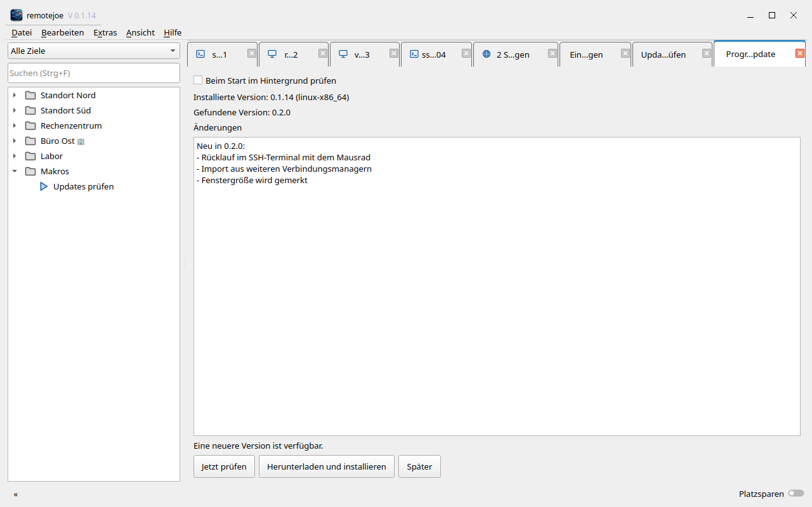

# Updates

remotejoe kann neue Versionen selbst finden, laden und installieren. Quelle sind die
Veröffentlichungen dieses Repositorys auf GitHub (`joeMJ/remotejoe`). Jedes Paket ist mit einem
Ed25519-Schlüssel signiert; das Programm installiert nur, was mit dem eingebauten öffentlichen
Schlüssel signiert ist und dessen Prüfsumme stimmt.



## Für Anwender

### Erstinstallation (Linux, Benutzerkonto)

```sh
curl -fsSL https://raw.githubusercontent.com/joeMJ/remotejoe/main/install.sh | bash
```

`install.sh` lädt die neueste Veröffentlichung, prüft **erst die Signatur**, **dann die Prüfsumme**,
entpackt in `~/.local/opt/remotejoe`, legt den Starter `~/.local/bin/remotejoe` und einen Eintrag
im Anwendungsmenü samt Programmsymbol an. Es braucht kein `sudo`. Fehlen Systembibliotheken (Qt 6,
FreeRDP 3, WebKitGTK), bricht es ab und nennt die `apt`-Pakete. Die bisherige Fassung bleibt als
`~/.local/opt/remotejoe.alt`. Entfernen: `bash install.sh --uninstall` (Einstellungen und
Schlüsseldatenbank bleiben). Offline aus einem Ordner mit den drei Dateien einer Veröffentlichung:
`bash install.sh --aus-ordner <Ordner>`.

Es gibt zwei Pakete: `…-linux-x86_64.tar.zst` (gebaut unter Ubuntu 26.04, für 26.04 und neuer) und
`…-linux-x86_64-ubuntu2404.tar.zst` (gebaut unter Ubuntu 24.04 mit Qt 6.4). `install.sh` und das Update
wählen das passende Paket nach `/etc/os-release`.

### Updates im Programm

**Hilfe → Nach Updates suchen …** öffnet den Tab „Programm-Update“. Die Quelle ist fest: die
öffentlichen Veröffentlichungen von `joeMJ/remotejoe` auf GitHub; Zugangsdaten braucht es nicht.
Im Tab gibt es:

| Bedienelement | Bedeutung |
|---|---|
| Jetzt prüfen | fragt die neueste Veröffentlichung ab |
| Herunterladen und installieren | lädt, prüft und installiert die gefundene Version |
| Später | schließt den Tab |
| Beim Start im Hintergrund prüfen | Voreinstellung aus; prüft einmal je Start, ohne den Start zu verzögern |

Die Einstellung steht in `config.toml`, Abschnitt `[update]`:

```toml
[update]
check_on_start = false
```

Ältere Einträge für Quelle, Adresse oder Zugriffsschlüssel werden ignoriert.

### Prüfen und installieren

1. „Jetzt prüfen“ fragt `…/releases/latest` ab (Gitea: `/api/v1/repos/{repo}/releases/latest`,
   GitHub: `/repos/{repo}/releases/latest`) und vergleicht nach SemVer mit der eingebauten
   Version. Ältere oder gleiche Versionen werden nie angeboten.
2. Der Tab zeigt installierte und gefundene Version und den Änderungstext (als reiner Text).
3. „Herunterladen und installieren“ lädt `SHA256SUMS.sig`, `SHA256SUMS` und das Archiv, prüft
   **zuerst die Signatur** und **dann die Prüfsumme**. Schlägt etwas fehl, bleibt alles, wie es
   war, und der Tab nennt den Grund.
4. Installation (Linux): Das Archiv wird in ein Nachbarverzeichnis `<programm>.neu` entpackt,
   dann wird das Programmverzeichnis ersetzt; die bisherige Fassung bleibt als
   `<programm>.alt`. „Jetzt neu starten“ ist freiwillig, bis dahin läuft die bisherige Fassung.
5. Sind Sitzungen offen, fragt der Tab vorher nach (Leiste im Tab).
6. Liegt das Programm unter `/usr` (Paketverwaltung) oder ist es ein Entwicklungsstand
   (`target/release` eines Arbeitsbereichs), verändert es sich nicht selbst; der Tab nennt nur
   den Download.

**Zurück zur alten Fassung:** Programm beenden, `<programm>` löschen oder umbenennen und
`<programm>.alt` zurückbenennen.

**Sicherheit:** nur `https` (Ausnahme `127.0.0.1`/`localhost` für Tests), Zertifikatsprüfung
gegen die Zertifizierungsstellen des Systems (nicht abschaltbar), höchstens 300 MB je Download,
Zeitlimit 10 Minuten, „Abbrechen“ jederzeit. Weiterleitungen nur auf `https`; beim Wechsel des
Hosts (z. B. Speicherdienst für Downloads) wird der Zugriffsschlüssel nicht mitgeschickt.

## Für Herausgeber

Das Werkzeug `rj-update` (`tools/update/`) erzeugt Schlüssel, packt, signiert und schließt
Veröffentlichungen ab.

```sh
cargo build --release -p remotejoe-update-tool    # liefert target/release/rj-update
```

### 1. Schlüsselpaar erzeugen (einmalig)

```sh
rj-update schluessel            # legt ~/.config/remotejoe/signing/update-key.{priv,pub} an
```

- `update-key.priv` – **privat**, Rechte 0600. Nur lokal aufbewahren und sichern (zum Beispiel
  als Anhang in der Schlüsseldatenbank oder auf einem Datenträger, der nicht ständig eingebunden
  ist). Nie in ein Repository und nie als GitHub-Secret: `.gitignore` schließt `*.priv` aus.
- `update-key.pub` – öffentlich; **zweimal** übernehmen: in `crates/ui/res/update-key.pub` (im
  Programm eingebaut) und als `UPDATE_KEY` in `install.sh`. Danach das Programm neu bauen.

### 2. Veröffentlichen über GitHub (Versions-Tag, Workflow, lokale Signatur)

1. Version in `Cargo.toml` anheben und committen.
2. Annotiertes Tag `vX.Y.Z` setzen (der Tag-Text wird zum Änderungstext) und nach GitHub
   schieben. Der Workflow `.github/workflows/release.yml` baut unter Ubuntu 26.04 das Paket
   (`scripts/package-linux.sh`) und legt einen **Entwurf** der Veröffentlichung mit
   `remotejoe-X.Y.Z-linux-x86_64.tar.zst` und `SHA256SUMS` an. Signiert wird dort nicht.
3. Lokal abschließen:

   ```sh
   secret-tool store --label='remotejoe GitHub' service remotejoe-github   # einmalig: Zugriffsschlüssel
   rj-update abschliessen joeMJ/remotejoe vX.Y.Z
   ```

   Das wartet auf den Entwurf, lädt Archiv und `SHA256SUMS`, rechnet die Prüfsummen nach,
   signiert `SHA256SUMS` mit dem lokalen privaten Schlüssel (nur wenn er zum eingebauten
   öffentlichen Schlüssel passt), lädt `SHA256SUMS.sig` hoch und veröffentlicht den Entwurf.
   Der Zugriffsschlüssel ist ein fein granulares GitHub-Token mit Schreibrecht auf „Contents“ nur
   für dieses Repository; er kann statt im Schlüsselbund auch in `RJ_GITHUB_TOKEN` stehen.

Ob `install.sh` und die Update-Funktion das Paket annehmen, lässt sich vor dem Veröffentlichen
lokal prüfen: `scripts/test-install.sh` (Wegwerf-Schlüssel, Wegwerf-Benutzerverzeichnis).

### Paket von Hand erzeugen und signieren

```sh
scripts/package-linux.sh 0.2.0 ausgabe/            # Archiv und SHA256SUMS (ohne Signatur)
rj-update packen programmordner 0.2.0 linux-x86_64 ~/.config/remotejoe/signing/update-key.priv ausgabe/
rj-update pruefen ausgabe/ crates/ui/res/update-key.pub
```

Ergebnis in `ausgabe/`: `remotejoe-0.2.0-linux-x86_64.tar.zst` (Windows:
`remotejoe-0.2.0-windows-x86_64.zip`), `SHA256SUMS`, `SHA256SUMS.sig`. Die Version muss der
Version in `Cargo.toml` des neuen Programms entsprechen.

**Gitea:**

```sh
export RJ_GITEA_TOKEN=…        # Token mit write:repository; nur in der Umgebung, nie in Dateien
rj-update hochladen https://git.example.test team/remotejoe v0.2.0 ausgabe/ aenderungen.txt
unset RJ_GITEA_TOKEN
```

### Schlüsselwechsel

1. Neues Schlüsselpaar erzeugen.
2. Eine Übergangsversion mit dem **alten** Schlüssel signieren, die bereits den **neuen**
   öffentlichen Schlüssel eingebaut hat, und veröffentlichen.
3. Ab der nächsten Version mit dem neuen Schlüssel signieren und `UPDATE_KEY` in `install.sh`
   anpassen.

Ist der alte private Schlüssel verloren oder kompromittiert, können bestehende Installationen
nicht mehr automatisch aktualisiert werden: neue Fassung mit dem aktuellen `install.sh`
installieren und den Anwendern mitteilen.
